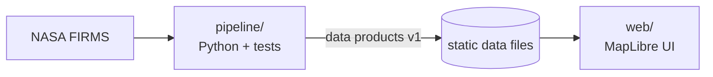

# Eyes on Karhutla

NASA Space Apps Challenge 2026: **Harmonization of MODIS and VIIRS Hot Spots**, focused on
Indonesian forest and land fires (*karhutla*). By **Dhien Exploration**.

| Folder | Language | Role |
|---|---|---|
| [`pipeline/`](pipeline/) | Python (uv) | Scientific source of truth: FIRMS ingestion, MODIS–VIIRS harmonization, activity metrics, research notebooks, internal Streamlit tool, and export of versioned data products. |
| [`web/`](web/) | TypeScript (npm, Vite) | Public map (React + MapLibre). Reads the exported data products; no scientific processing. |

Hotspots are detections of thermal anomalies, not confirmed fires. Generated data is never
committed. See `pipeline/README.md` to pull FIRMS data and export it.
