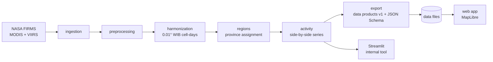
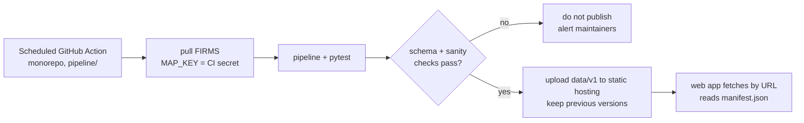

# Pipeline Architecture

How satellite detections become the data behind the public Eyes on Karhutla map, and how that data
is kept up to date. For setup and commands, see the [pipeline README](../README.md).

> Status: **Stage 1 (local export) works** (contract v1, multi-year archive: `archive.py` +
> `export.py`). Stage 2 (automated publishing) is planned. Architecture decision: see `AGENTS.md` §13.

## 1. Data flow

This package computes everything; `web/` only reads the exported data products (see the
[root README](../../README.md) for how the monorepo is split).



**Rule:** if the web app needs a new number, it is computed here, tested, and exported. The browser
only displays, filters and formats.

## 2. Pipeline steps

| Step | Module | Output |
|---|---|---|
| Ingest | `ingestion.py` | Raw FIRMS rows with provenance (`source`, `source_ref`, `retrieved_at`), saved unchanged in `data/raw/`. |
| Normalize | `preprocessing.py` | One schema for all sensors. Invalid rows are excluded **with a reason**, never dropped silently. |
| Harmonize | `harmonization.py` | Keep FIRMS `type = 0`, snap to a 0.01° cell and WIB date, one row per active cell-day with per-satellite flags. |
| Regions | `regions.py` | Each cell-day gets a province ID, or "outside provinces" (sea, coast, neighbouring countries). |
| Activity | `activity.py` | Daily or period series per region: `modis` (Terra + Aqua) and `viirs_snpp` side by side, never summed. Partial dates are flagged. |
| Export | `export.py` | Versioned data files + `manifest.json` + JSON Schemas, validated before they are written as final. |

Scientific meaning, kept identical in the web app:
- An **active cell-day** is a 0.01° cell (~1.1 km) with at least one detection on a WIB date. It is
  not a fire count, burned area or intensity.
- Hotspots are **detections of thermal anomalies, not confirmed fires**.
- MODIS and VIIRS are never summed. VIIRS sees about 3× (S-NPP) to 5.5× (all VIIRS) more, because
  it is more sensitive.

## 3. Data products

### Contract v1 (multi-year, `SCHEMA_VERSION = "1.0.0"`)

```text
data/v1/
├── manifest.json                 # coverage periods, year/month status, series + platform periods,
│                                 # sources + files, exclusions, totals per year, file index
├── schema/                       # manifest / provinces / daily / monthly / cells
├── provinces.geojson             # shapes once; totals, totals_by_year, n_active_cells_by_year
├── monthly.json                  # Indonesia (= sum of provinces)
└── provinces/{province_id}/
    ├── daily.json                # every date in range: status complete | partial | missing
    ├── monthly.json              # every month in range, same status rule
    └── cells/{YYYY}.geojson      # active cells for one WIB year
```

- **Coverage:** a date is covered only when both required sources (MODIS, VIIRS S-NPP) cover it.
  Gaps are allowed and listed in `coverage.periods`.
- **Missing is never zero:** missing dates and months have `null` values.
- **Monthly and yearly values** sum complete WIB dates only.
- **"Indonesia"** is the sum of provinces. Cells in the FIRMS bounding box but outside every
  province are reported separately.
- **Cross-file checks** run before writing: year totals = daily sums = monthly sums per province;
  Indonesia = Σ provinces; Indonesia + outside = everything.
- **Year** = WIB calendar year. `series.*.platform_periods` gives the first and last date each
  satellite was seen.
- `province_id` comes from the boundary data's ISO 3166-2 code. `cell_id` is `"{cell_i}_{cell_j}"`
  (integer grid indices at 0.01°), which stays stable as long as the grid is unchanged.
- **Every exported field is typed** in its JSON Schema. The exporter refuses to write a field its
  schema does not describe.
- **Versioning:**
  - Schema clarifications that change no exported value keep the same version.
  - Additive changes (new fields) bump the minor version and keep `v1/`.
  - Breaking changes bump the major version and go to a new `v2/` folder.
  - The web app reads `schema_version` and refuses unknown major versions.
- **Keeping both halves in sync:** the JSON Schemas are written by the exporter. The web app
  generates its TypeScript types from them and validates data when it loads. Because both live in
  one repo, a schema change and the matching web change go in the same pull request.

Raw input is the local archive `data/raw/firms/{source}/{start}_{end}.csv`, filled by
`python -m eyes_on_karhutla.archive pull` (see the [pipeline README](../README.md)).

## 4. Delivering data to the web app

### Stage 1: local (one command)

```bash
uv run python -m eyes_on_karhutla.archive pull --start 2012-01-01     # fill the raw archive
uv run python -m eyes_on_karhutla.export --out ../web/public/data/v1
```

The exporter writes straight into `web/public/data/`. Rerun it whenever the data changes. There is no manual copying. It refuses to overwrite a folder that isn't a previous export.
Cell files compress well (8.2 MB → 0.35 MB gzipped for the largest province), so the web host must
serve compressed files.

### Stage 2: automated publishing



- Data is **not committed** to git. It is fetched from static hosting (GitHub Pages or
  Releases, or object storage such as R2/S3; to be decided).
- Data updates don't redeploy the website, and website changes don't regenerate data.
- Nothing is published unless the tests and validation pass. Earlier versions stay available for
  rollback.
- Data contributors open pull requests against `pipeline/`, and the same job publishes the result.

## 5. Open questions

| Question | Notes |
|---|---|
| How current can the data be? | The archive used now (FIRMS *standard processing*, SP) is published with a delay (to be checked). Recent days exist only as *near real-time* (NRT) products, which have no FIRMS `type` field, and the pipeline rejects those on purpose. Options: archive only, or a separate, labelled "provisional" NRT layer with a documented method. |
| Boundary source | Current: geoBoundaries (OpenStreetMap, **ODbL 1.0**), **34 provinces (2017)**. Indonesia has 38 since 2022. A current source is needed. |
| Province vs. island-group view | Not decided. Island groups could be aggregated from provinces. |
| Data hosting and licence | Where exported files live, and the licence for exported data (must respect FIRMS terms and ODbL for boundaries). |
| Multi-year size | Per-province files are fine for one season. Multi-year national layers may need vector tiles (PMTiles). |

## 6. Future: community reports

Moderated community reports (residents' situation updates, social-media findings) will be a
**separate layer** with its own backend and admin approval. They never change the satellite data
products described here. See `AGENTS.md` §13.2.
