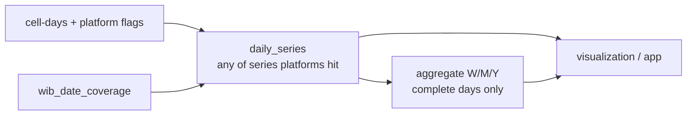

# Activity Series

`src/eyes_on_karhutla/activity.py` turns cell-days
([cell-day-method](../harmonization/cell-day-method.md)) into **side-by-side sensor series** of
active cell-days. Tests are in `tests/test_activity.py`; checks on real data are in notebook 02,
section 6.

## Series (fixed constellations, never summed)
| Key | Label | Platforms | Consistent since |
|---|---|---|---|
| `modis` | MODIS (Terra + Aqua) | terra, aqua | 2002 (Aqua launch; Terra-only before) |
| `viirs_snpp` | VIIRS S-NPP | snpp | 2012 |
| `viirs_all` | VIIRS all satellites | snpp, noaa20, noaa21 | **not consistent**: jumps when NOAA-20 (2018) and NOAA-21 start |

`DEFAULT_SERIES = ("modis", "viirs_snpp")`.

Why side by side? VIIRS has about 5.5× as many active cell-days as MODIS because it is more
sensitive, and the ratio varies daily (2.4–12×). A sum or a fixed factor would mix sensors in a
misleading way. Why fixed platforms? In 2019, S-NPP alone gives only about 60% of all-VIIRS
cell-days, so adding a satellite changes the level of the series.

Platform end-of-life and orbit drift (Terra and Aqua late in their missions) are **unknown /
unchecked** and must be verified before extending series past about 2020.

## API
```python
import datetime as dt
from eyes_on_karhutla import activity
daily = activity.daily_series(cell_days, dt.date(2019, 8, 1), dt.date(2019, 10, 31))
monthly = activity.aggregate(daily, "M")   # also "W", "Y"
```
- `wib_date_coverage(utc_start, utc_end)` lists the WIB dates from `utc_start` to `utc_end + 1`.
  Only `utc_start + 1 .. utc_end` are `complete`, because a WIB date spans UTC D-1 17:00 to D 17:00.
- `daily_series` has one row per WIB date in coverage, an int column per series (zero-filled, so
  quiet days are 0 rather than missing) and a `complete` flag.
- `aggregate` sums **complete days only** and reports `n_complete_days` vs. `n_days` (calendar days
  in the period), so a partly covered period is not mistaken for a quiet one. Periods with no
  complete days are absent.

The UTC range must be passed in explicitly: it is the pull range, which may include days with no
detections. It cannot be inferred from the data.



## Sample result (2019, bbox not clipped)
| Month | modis | viirs_snpp | viirs_all |
|---|---|---|---|
| 2019-08 (30/31 complete) | 12,095 | 38,418 | 65,258 |
| 2019-09 | 37,118 | 100,852 | 158,636 |
| 2019-10 | 14,512 | 54,737 | 91,714 |

## Not yet done
- Region filtering (needs province boundaries).
- Baselines and anomalies (needs multi-year data).
- Calendar-shaped output for the heatmap (to live in `visualization.py`).

Related: [cell-day-method](../harmonization/cell-day-method.md) · [roadmap](../plans/roadmap.md) ·
[terminology](../terminology.md)
