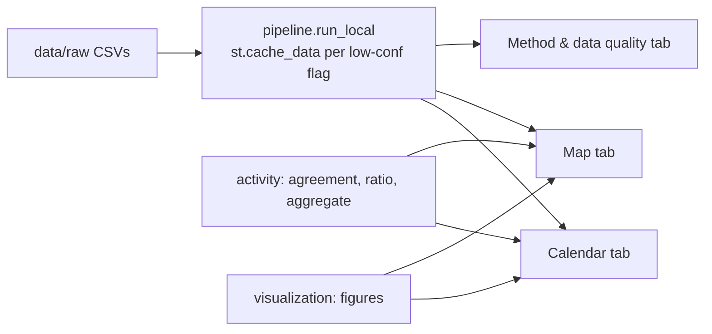

# Streamlit App, Pipeline and Visualization

`app.py` is an **internal analysis and validation tool**. The public product is the JS package
`web/` in the same monorepo (AGENTS.md §13.1). It handles UI and orchestration only. Run it with
`uv run streamlit run app.py`. It reads local raw files in `data/raw/` and makes no API calls.

## Layers
- `pipeline.run_local(sources=SP_SOURCES, exclude_low_confidence=False) -> Result` chains
  `latest_raw` → `read_firms_csv` → `normalize` → `prepare` → `to_cell_days` → `daily_series`.
  It checks `len(kept) + len(excluded) == len(raw)`. All sources must share one pull range, or it
  raises `ValueError`.
- `Result` has these fields: `cell_days`, `daily` (all three series), `excluded` (preprocessing and
  harmonization reasons), `utc_start`, `utc_end` and `provenance` (file, range, raw and kept rows per
  source).
- `ingestion.pull_range(path)` parses the UTC pull range from the raw file name
  `{source}_{YYYY-MM-DD}_{YYYY-MM-DD}_{stamp}.csv`. The range is the requested window, so it cannot
  be inferred from detections.
- `visualization.py` prepares figures only and does no science. Agreement and ratios come from
  `activity.sensor_agreement` and `activity.series_ratio`.

## Page contents
- **Sidebar.** "Also show VIIRS all satellites" (off by default, with a warning that it isn't
  consistent across 2018) and "Exclude low-confidence detections" (sensitivity check; reruns the
  cached pipeline).
- **Header.** The caveat that hotspots are detections, not fires. Metrics: complete WIB dates,
  active cell-days per series, and same-cell agreement (MODIS cell-days also hit by S-NPP; 46% in 2019).
- **Activity calendar.** A weekday × week heatmap per series (`calendar_grid` blanks partial and
  out-of-range dates instead of showing 0), a daily line chart, the S-NPP ÷ MODIS daily ratio with
  its median, and a monthly table with "Days covered".
- **Map.** WIB date range slider (max 7 days, default the MODIS peak day). Cell-centre points
  coloured Both / MODIS only / S-NPP only (`px.scatter_map`, carto-positron, no token). "Both" is
  drawn last so it isn't hidden.
- **Method & data quality.** The pipeline steps, provenance table, exclusions by reason, coverage
  (partial dates, low-only share), limitations and FIRMS attribution.

## Visual conventions
- Colours: validated reference palette slots 1–3 (CVD-safe all-pairs). MODIS `#2a78d6`, VIIRS
  `#eb6834`, Both `#1baf7a`. Colour means sensor family. `viirs_all` reuses orange with a dotted line.
- Calendars share one sequential blue ramp, and each panel has its own colour bar. Scales differ
  per series, which the caption says.
- Never stack or sum MODIS and VIIRS. Every figure names the metric "active cell-days".

## Verification
- `streamlit.testing.v1.AppTest.from_file(<absolute path to app.py>)` runs the page with both
  sidebar toggles and checks there are no exceptions or errors. This is an ad-hoc script, not in
  `tests/`, because it needs the local raw data.
- Visual check: Playwright with `channel="chrome"` via `uv run --no-project --with playwright`.
  Use a tall viewport (2600 px), because Streamlit scrolls inside a container and `full_page` stops
  at the viewport.

## Known gaps
- No region filter (needs boundaries), no multi-year view (needs data), and the FIRMS citation
  wording still needs to be verified against the FIRMS citation page.
- First load runs the pipeline in about 8–10 s on the 2019 sample. A cached processed file
  (parquet) is a likely next step once the data is multi-year.

Related: [activity](../activity/summary.md) · [cell-day-method](../harmonization/cell-day-method.md) ·
[firms-api](../data/firms-api.md) · [practices](../practices.md)
