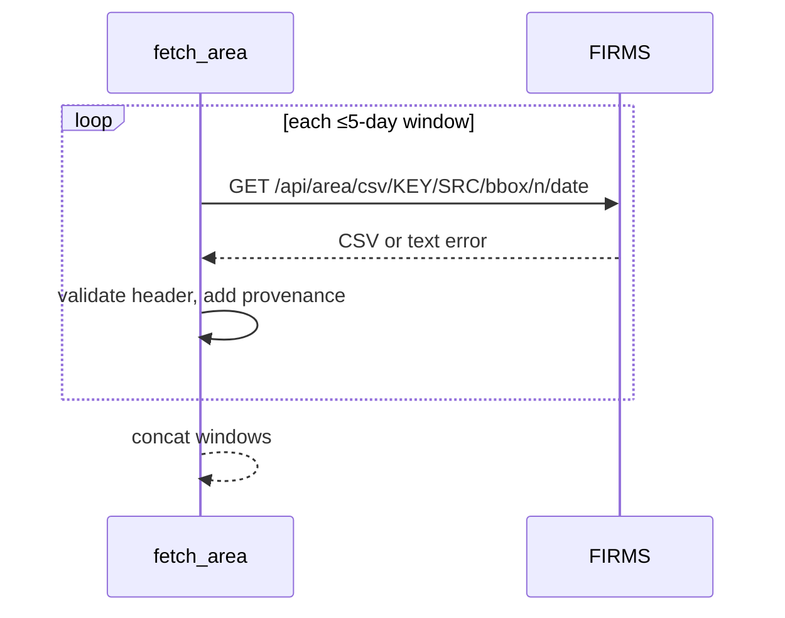

# FIRMS Area API and Ingestion

## Contract (verified 2026-10-20 at https://firms.modaps.eosdis.nasa.gov/api/area/)
- URL: `/api/area/csv/[MAP_KEY]/[SOURCE]/[west,south,east,north]/[DAY_RANGE]/[YYYY-MM-DD]`
- `DAY_RANGE` is 1..5. `DATE` is optional; without it the API returns the most recent data.
- Sources: `MODIS_NRT`, `MODIS_SP`, `VIIRS_SNPP_NRT`, `VIIRS_SNPP_SP`, `VIIRS_NOAA20_NRT`,
  `VIIRS_NOAA20_SP`, `VIIRS_NOAA21_NRT`. `LANDSAT_NRT` covers US/Canada only and is excluded.
- Limit: 5000 transactions per 10 minutes per MAP_KEY. **One 5-day area request over
  `INDONESIA_BBOX` costs about 11 transactions** (measured 2026-10-26: ~450 calls exhausted the
  budget). The sustainable rate is therefore about 450 area calls per 10 minutes, so a full
  2012–2026 pull (~2,530 calls) takes at least about an hour.
- When the budget is spent, FIRMS answers with the body **"Exceeding allowed transaction limit."**:
  HTTP 400 on `/api/area`, **HTTP 403** on `/api/data_availability`. `ingestion._get` recognises
  the text on any 4xx and waits `RATE_LIMIT_WAIT_S` (60 s) up to `RATE_LIMIT_MAX_WAITS` (15)
  times. Other 4xx fail at once.
- Usage check: `/mapserver/mapkey_status/?MAP_KEY=…` returns `transaction_limit`,
  `current_transactions` and `transaction_interval`.
- Coverage check: `/api/data_availability/csv/[MAP_KEY]/all` (not wrapped yet). It returns
  `data_id,min_date,max_date`. As of 2026-10-24:

  | Source | Min | Max |
  |---|---|---|
  | MODIS_SP | 2000-11-01 | 2026-07-31 |
  | VIIRS_SNPP_SP | 2012-01-20 | 2026-06-30 |
  | VIIRS_NOAA20_SP | 2018-04-01 | 2026-06-30 |
  | VIIRS_NOAA21_SP | 2023-03-01 | 2026-06-30 |
  | MODIS_NRT | 2026-08-01 | today |
  | VIIRS_*_NRT | 2026-07-01 (NOAA-21: 2024-01-17) | today |

  SP lags by about 3–4 months, and NRT only covers the gap since then. **`VIIRS_NOAA21_SP` exists
  but is not yet in `config.FIRMS_SOURCES` / `VIIRS_PLATFORM_BY_SOURCE`.** FIRMS also lists
  burned-area products `BA_MODIS` and `BA_VIIRS` (not used).
- Not verified: the country API. Its docs page returned HTTP 400.

## Implementation (`src/eyes_on_karhutla/ingestion.py`)
- `build_area_url` validates the source and day range.
- `fetch_area(source, bbox, start, end)` splits the inclusive range into windows of at most 5 days.
- FIRMS can return plain-text errors with HTTP 200. Any body that doesn't start with `latitude`
  raises `RuntimeError`.
- All FIRMS GETs go through `_get`. It retries 5xx, 429 and network errors 3 times with waits of
  5, 15, 45, 120 and 300 s (`RETRY_BACKOFF_S`, about 8 min, enough to ride out a short network drop), and fails at once on other 4xx.
- **Errors never contain the MAP_KEY.** `requests` puts the full URL (key included) into its
  exception messages, so `_get` re-raises every failure as `RuntimeError` with the redacted URL and
  `from None` (no chained cause). Lesson: a 504 traceback during the first multi-year pull printed
  the key into a local log before this was fixed.
- Observed during the 2019–2020 pull (2026-10-24): FIRMS returned a 504 Gateway Time-out mid-year,
  and throughput was about 15–20 calls per minute, slower than the earlier ~57 per minute. Budget
  about 4 min per source-year.
- `acq_time` and `confidence` are read as `str`. FIRMS sends `acq_time` without leading zeros
  (`200` means 02:00), and preprocessing pads it.
- `save_raw(df, name)` writes `data/raw/{name}_{UTC stamp}.csv`. `latest_raw(source)` returns
  the newest file whose name starts with `source.lower()`.
- Naming convention (required by `pipeline`): `name = f"{source.lower()}_{start}_{end}"`, so files
  look like `viirs_snpp_sp_2019-08-01_2019-10-31_<stamp>.csv`. `pull_range(path)` parses the UTC
  range back out and raises `ValueError` on any other name.
- The live key was confirmed on 2026-10-20. A 92-day pull of 3 sources (57 calls) took about 1 minute.
- Provenance columns are `source`, `source_ref` (URL with the key redacted, or a file path) and
  `retrieved_at`.

## Study area
`config.INDONESIA_BBOX = (94.0, -11.5, 141.5, 6.5)`. This box also covers parts of Malaysia,
Brunei, Singapore, Timor-Leste, PNG and the southern Philippines, so detections must be clipped
to official boundaries before regional statistics.



```python
ingestion.build_area_url("VIIRS_SNPP_SP", (94, -11.5, 141.5, 6.5), 5, date(2019, 9, 1), map_key="KEY")
# https://firms.modaps.eosdis.nasa.gov/api/area/csv/KEY/VIIRS_SNPP_SP/94,-11.5,141.5,6.5/5/2019-09-01
```

**Lesson:** a request for one year is 73 calls per source. Cache raw pulls with `save_raw` and
don't re-fetch.

Related: [summary](summary.md) · [observation-schema](observation-schema.md)
