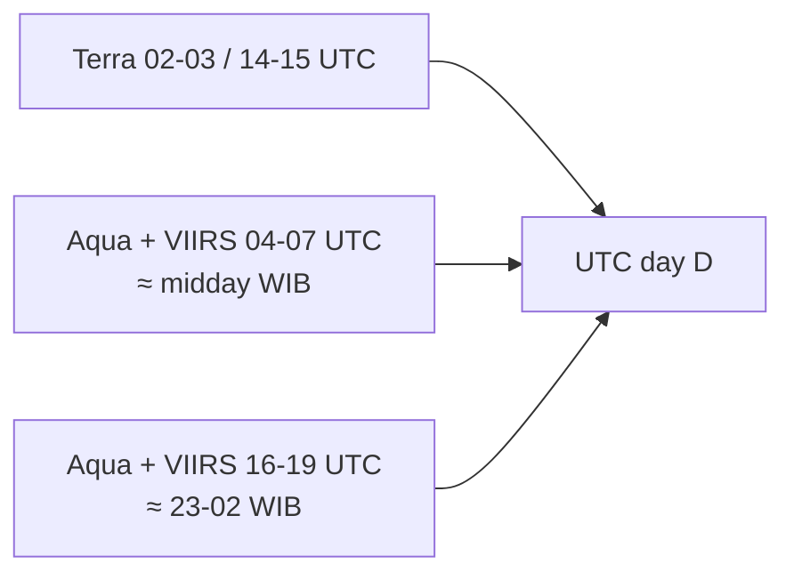

# FIRMS Sample: Indonesia bbox, 2019-08-01 → 2019-10-31

The reference dataset for exploration and method design is real FIRMS SP data pulled with
`fetch_area` over `config.INDONESIA_BBOX` (not clipped to Indonesia). The raw files are in
`data/raw/{source}_2019-08-01_2019-10-31_<UTC stamp>.csv` and are not committed. They are
explored in `notebooks/01_explore_nasa_data.ipynb`; harmonization is checked on it in
`notebooks/02_compare_modis_viirs.ipynb`. A UTC-bounded pull makes the first and last WIB dates
(2019-08-01, 2019-11-01) partial.

## Facts observed
| | MODIS_SP | VIIRS_SNPP_SP | VIIRS_NOAA20_SP |
|---|---|---|---|
| rows (all valid) | 75,483 | 362,247 | 362,218 |
| `satellite` codes | `Terra` 29,383 / `Aqua` 46,100 | `N` | `N20` |
| days with data | 92/92 | 92/92 | 92/92 |
| `type` ≠ 0 | 3.4% | 1.9% | 2.8% |
| confidence | numeric 0–100, median 70 | l 7% / n 89% / h 4% | l 7% / n 89% / h 4% |
| median scan × track (km) | 1.2 × 1.1 (max 4.8 × 2.0) | 0.43 × 0.44 | 0.43 × 0.44 |
| median FRP (MW) | 19.3 | 4.65 | 4.61 |

- `type` (meanings from FIRMS docs, to be re-confirmed): 0 presumed vegetation fire, 1 active
  volcano, 2 other static land source, 3 offshore. Every SP row has it.
- Daily VIIRS S-NPP / MODIS count ratio: median 5.0, range **1.07–10.3**. A single fixed
  conversion factor is not defensible.
- Daily count correlation: MODIS–S-NPP 0.90, MODIS–NOAA-20 0.90, S-NPP–NOAA-20 0.98.
- Dominant UTC overpass hours:
  - Terra: 02–03 and 14–15 (about 09–10 and 21–22 WIB)
  - Aqua: 04–06 and 17–18
  - S-NPP: 04–07 and 17–19
  - NOAA-20: 04–07 and 16–18
  - The night passes at 17–18 UTC fall at 00–01 WIB on the *next* local date.

## Implications for harmonization
- Raw counts must not be summed or compared across sensors.
- FRP per detection differs by pixel size, so per-detection FRP is not comparable either.
- S-NPP and NOAA-20 *daily totals* correlate at r = 0.98, but per 0.01° cell-day they are not
  redundant: 39% of VIIRS cell-days are NOAA-20 only (notebook 02).
- The VIIRS excess is mostly sensitivity, not pixel size. It persists on cell-days
  ([cell-day-method](../harmonization/cell-day-method.md)).
- With a UTC date, one date holds the local afternoon pass plus the following 00–01 WIB pass.
  With a WIB date, that night pass moves to the next date.



```python
from eyes_on_karhutla import ingestion, preprocessing
raw = ingestion.read_firms_csv(ingestion.latest_raw("VIIRS_SNPP_SP"), "VIIRS_SNPP_SP")
obs, excluded = preprocessing.normalize(raw)   # 362,247 obs, 0 excluded
```

Related: [firms-api](firms-api.md) · [method-options](../harmonization/method-options.md)
