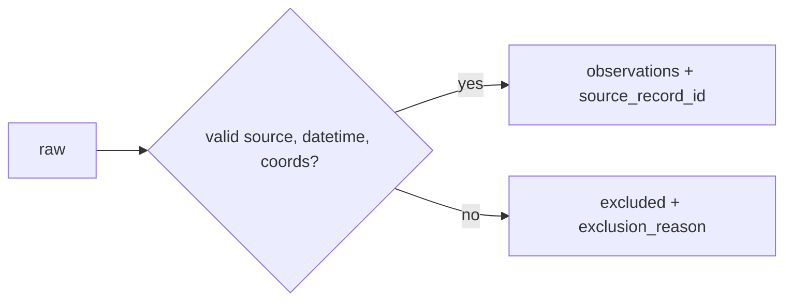

# Normalized Observation Schema

Produced by `preprocessing.normalize(raw) -> (observations, excluded)`.

| Field | Type | Null | Meaning |
|-------|------|------|---------|
| latitude, longitude | float | no | WGS84 degrees, validated to range |
| acq_datetime | datetime64[UTC] | no | from `acq_date` + `acq_time` (HHMM UTC, zero-padded) |
| sensor | str | no | `MODIS` or `VIIRS`, derived from `source` via `config.FIRMS_SOURCES` |
| satellite | str | yes | original FIRMS value, unchanged (`Terra`, `Aqua`, `N`, `N20` observed) |
| type | int | yes | FIRMS SP: 0 vegetation fire, 1 volcano, 2 static land, 3 offshore. Passed through here; `harmonization.prepare` keeps only 0 |
| confidence | string | yes | original value: MODIS `0–100`, VIIRS `l/n/h`. `harmonization` derives `confidence_class`; the classes are not equivalent across sensors |
| frp | float | yes | fire radiative power, MW |
| scan, track | float | yes | pixel size, km |
| daynight | str | yes | `D`/`N` |
| source | str | no | FIRMS source, e.g. `MODIS_SP` |
| source_record_id | str | no | first 16 hex chars of sha1(source, lat, lon, acq_date, acq_time, satellite) |
| source_ref, retrieved_at | str, datetime | no | provenance from ingestion |

All other raw columns (`brightness`, `bright_t31`, `bright_ti4`, `bright_ti5`, `version`, …) pass
through unchanged.

## Invariants
- `len(observations) + len(excluded) == len(raw)`
- Exclusion reasons: `unknown_source`, `invalid_acq_datetime`, `invalid_coordinates`. When a row
  has several problems, coordinates take precedence.
- `source_record_id` is deterministic for identical input.



```python
obs, excluded = preprocessing.normalize(raw)
excluded.groupby("exclusion_reason").size()
```

Related: [firms-api](firms-api.md) · [practices](../practices.md)
