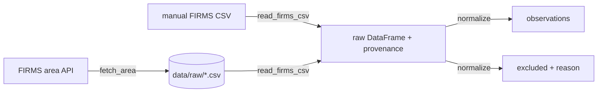

# Data Sources

| Source | Role | Access | Status |
|--------|------|--------|--------|
| NASA FIRMS (MODIS C6.1, VIIRS 375 m) | primary observations | area CSV API with MAP_KEY | working; sample pulled, see [firms-sample-2019](firms-sample-2019.md) |
| SiPongi+ (Kemenhut) | comparison/validation only | official site; permitted methods only | not researched |
| Province boundaries | regional clipping | TBD | not chosen |

Raw pulls go to `data/raw/` unchanged and are not committed. Processed outputs go to
`data/processed/`.

**Known from real data:** the `satellite` codes are `Terra`/`Aqua` (MODIS), `N` (S-NPP) and
`N20` (NOAA-20). SP responses include a `type` column.
**Still unknown:** the full per-source date coverage (`/api/data_availability/`), the satellite
code for NOAA-21 in NRT data, and whether NRT responses include `type`.



```python
raw = ingestion.read_firms_csv(ingestion.latest_raw("MODIS_SP"), "MODIS_SP")
obs, excluded = preprocessing.normalize(raw)
```

Related: [firms-api](firms-api.md) · [observation-schema](observation-schema.md)
