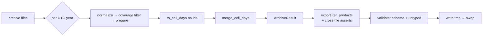

# Multi-Year Data: Raw Archive and Pipeline

Implemented in `archive.py`, `pipeline.run_archive` and `activity` (status functions). The export
built on it is [summary](summary.md) (contract v1). Tests: `test_archive.py`, `test_export.py`,
plus additions to the harmonization and activity tests. The owner decisions on the web side are in
`../web/lode/plans/multi-year.md`.

## Owner decisions (2026-10-24)
- **"Indonesia" = sum of the provinces.** Bounding-box cells outside every province are a
  separate `outside_provinces` number and never part of Indonesia's series.
- **Dense series with status:** `daily.json` and `monthly.json` list every date or month in range
  with `status` complete | partial | missing. Values are `null` when missing, never 0.
- The time unit for the UI is the **WIB calendar year**. Cell dots exist per year only.

## Raw archive (`archive.py`)
- `data/raw/firms/{source_lower}/{start}_{end}.csv`, one file per source per UTC year, named by its
  inclusive pull range. The files are git-ignored and never edited (provenance).
- `list_files` raises on bad names, multi-year files or overlaps. `merge_ranges` joins adjacent
  ranges.
- `coverage()`: **covered periods** are the intersection of the required sources
  (`config.REQUIRED_SOURCES` = MODIS_SP, VIIRS_SNPP_SP). Gaps are allowed. Optional sources
  (NOAA-20, NOAA-21) only feed `viirs_all`.
- `plan_pull` clamps each year to the request and to `ingestion.data_availability()`. It skips
  covered years and widens the window to any existing partial file of that year, which it then
  replaces. Several partial files in one year raises. `default_end` is the earliest required
  `max_date`.
- `pull` caches each 5-day window in a hidden `.{start}_{end}.parts/` folder next to the target
  (`fetch_area(cache_dir=…)`), so rerunning after an interruption resumes at the window level. It
  then writes `.csv.part`, renames it, removes the cache and deletes any replaced file. Progress is
  printed every 10 windows.
- **CLI:** `python -m eyes_on_karhutla.archive status | pull --start D [--end D] [--sources …] [--dry-run]`.

## Pipeline (`pipeline.run_archive(start=None, end=None, root=None)`)
- It loops over UTC years. For every archive file of that year, it reads, then runs `normalize`,
  then filters coverage, then `prepare`, then `to_cell_days(keep_record_ids=False)`.
- Detections whose UTC date is outside the covered periods get the reason `outside_coverage`. The
  invariant `kept + excluded == raw` is asserted per year.
- `harmonization.merge_cell_days` merges `(cell, wib_date)` duplicates across years (31 Dec ≥17:00
  UTC is 1 Jan WIB). It ORs hits, sums counts and ANDs `low_conf_only`.
- `ArchiveResult` holds:
  - `cell_days`, `periods`, `coverage` (`activity.coverage_status`), `source_ranges`;
  - `files` (raw and kept rows **per file**, counted via `source_ref`);
  - `exclusions` (source, year, reason, rows);
  - `platform_seen` (first and last WIB date per platform).

## Activity (status functions)
- `coverage_status(periods)` gives every WIB date from the first to the last touched date. Each UTC
  period has partial WIB edges, as in `wib_date_coverage`; dates between periods are missing.
- `daily_with_status(cell_days, coverage)` returns nullable `Int64` values, NA on missing dates.
- `period_series(daily, "M"|"Y")`: status is complete if all days are complete, missing if all are
  missing, else partial. Values sum complete days; NA if missing.

## Full export results (2012-01-20 → 2026-06-30, pulled 2026-10-25/27)

- **Raw archive:** 4 SP sources, 1.6 GB of CSV. MODIS from 2012-01-01; S-NPP from 2012-01-20;
  NOAA-20 from 2018-04-01; NOAA-21 from 2023-03-01; all end 2026-06-30 (pinned with `--end`, as
  NOAA-20 SP ends there while MODIS and S-NPP SP already reach 2026-07-31). Pull time ≈ 2–3 h
  at the FIRMS transaction limit.
- **Export:** 243 s, peak RSS 2.47 GB (the busiest year does not raise the peak noticeably),
  581 files, 693 MB raw. Largest: `ID-KT/cells/2015.geojson` 14.5 MB raw / 0.75 MB gzip.
  `provinces.geojson` 610 KB, `manifest.json` 46 KB, `monthly.json` 6 KB, a `daily.json` ≈ 165 KB.
  **The web host must serve gzip** (cells compress ~20×).
- **Coverage:** 2012 and 2026 partial, 2013–2025 complete. Partial dates: 2012-01-20 (UTC start)
  and 2026-07-01 (7 h after the UTC end). The latter is not trimmed, because 2026 has complete
  dates; it makes month 2026-07 `partial`. Nothing trimmed.
- **Indonesia by year (active cell-days, complete dates; modis / viirs_snpp / viirs_all):**

  | Year | MODIS | S-NPP | VIIRS all | | Year | MODIS | S-NPP | VIIRS all |
  |---|---|---|---|---|---|---|---|---|
  | 2012* | 62,818 | 206,674 | 206,674 | | 2020 | 13,158 | 62,410 | 116,120 |
  | 2013 | 47,290 | 156,035 | 156,035 | | 2021 | 11,339 | 45,749 | 86,672 |
  | 2014 | 95,088 | 321,840 | 321,840 | | 2022 | 8,698 | 37,777 | 74,959 |
  | 2015 | 141,596 | 486,761 | 486,761 | | 2023 | 45,063 | 161,994 | 364,268 |
  | 2016 | 20,757 | 76,041 | 76,041 | | 2024 | 18,685 | 69,825 | 185,982 |
  | 2017 | 15,163 | 64,553 | 64,553 | | 2025 | 14,312 | 64,281 | 155,959 |
  | 2018 | 32,928 | 126,284 | 217,168 | | 2026* | 4,731 | 18,655 | 46,655 |
  | 2019 | 76,978 | 240,683 | 396,694 | | | | | |

  \* partial year. The known big fire years (2015, 2019, 2023 El Niño) stand out in every series.
  S-NPP/MODIS stays 3.1–4.7×; `viirs_all` jumps in 2018 (NOAA-20) and 2023 (NOAA-21), so only
  `viirs_snpp` is comparable across all years.
- 2019 MODIS is 76,978 here vs. 76,975 in the 2019–2020 trial: with the 2018 file present, 31 Dec
  2018 ≥17:00 UTC detections now complete 1 Jan 2019 WIB (expected).
- Totals 2012–2026: Indonesia 608,604 / 2,139,562 / 2,956,381; outside provinces 81,703 /
  308,312 / 433,587.
- **Memory (measured):** the peak comes from processing one UTC year's raw detections in
  `run_archive`, not from the number of years. An earlier guess of ">10 GB for 2012–2026" was
  wrong.

## Lessons
- A ~1 min network drop killed a 1 h 40 min pull; `RETRY_BACKOFF_S` now spans ~8 min.
- A whole-year file as the unit of retry was too coarse: one failed window after a 3 h run (the
  machine likely slept) threw the year away. Window caching fixed it.
- `run_archive` first keyed files by source per year, which silently kept one file when a year had
  two (around a gap). It now iterates every file. The synthetic test has a gap year to cover this.
- `existing[[bool list]]` on an empty DataFrame selects **columns**, not rows. Use
  `existing[series.map(...).astype(bool)]`.

## Open
- An NRT "provisional" layer after the SP end is the owner's decision.
- S-NPP's long-term status is not verified past 2026.
- `pipeline.run_local` and the single-range files in `data/raw/*.csv` remain only for the
  Streamlit tool, the province-click spike and the notebooks. Moving them onto `run_archive` is
  open.

Related: [summary](summary.md) · [firms-api](../data/firms-api.md) ·
[cell-day-method](../harmonization/cell-day-method.md) · [activity](../activity/summary.md)
