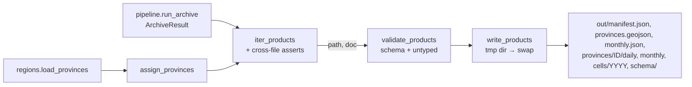

# Regions and Data-Product Export (contract v1, multi-year)

This package exports versioned, schema-validated data files for the public web app (`web/` in the
same monorepo; AGENTS.md §13.1). There is **one** contract: v1, multi-year, built from the raw
archive. How the archive and `run_archive` work: [multi-year-archive](multi-year-archive.md).
Step-by-step how-to: `pipeline/README.md`. Human-readable design: `docs/architecture.md` §3. This package owns the schema.

```bash
uv run python -m eyes_on_karhutla.export --out ../web/public/data/v1 [--start D] [--end D] [--boundaries F]
# one year ≈ 35 s; 2012–2026 ≈ 4 min, peak RSS ≈ 2.5 GB
```

## Modules
- `regions.load_provinces(path=None)` returns `province_id` (ISO 3166-2, e.g. `ID-KT`), `name` and
  geometry, sorted by id. Ids must be unique and present. Metadata is in `config.BOUNDARIES`
  (geoBoundaries / OSM, ODbL 1.0, 34 provinces, 2017).
- `regions.assign_provinces(cell_days, provinces)` gives a `province_id` per cell-day, using the
  **cell centre** and `intersects`. A centre on a shared border matches both provinces and the first
  id in sort order wins (deterministic). NA means **outside provinces**. Assignment uses the
  unsimplified file; display geometry is simplified separately (0.005°, 1e-4° precision).
- `export.iter_products(result, provinces)` yields `(path, doc)` one at a time: per-province files
  first, then `provinces.geojson`, `monthly.json`, `manifest.json`. Cross-file invariants are
  checked with running totals and raise before the summary files are yielded.
- `export.build_products(...)` = `dict(iter_products(...))`, for tests and small ranges.
- `export.validate_products(products)` checks each document against `export.SCHEMAS` (JSON Schema
  2020-12, picked by `export.kind_of(path)`), then runs `export.untyped_fields`, which fails if any
  field has no `type`/`const`/`enum`/`oneOf` in its schema. Either failure raises `ValueError`
  naming the file and the field paths. Lists are checked through their first element.
- `export.write_products(items, out)` validates and writes each item into `out.tmp-export`, writes
  `schema/*.schema.json`, and swaps the folder in only after the iterator finished. On any failure
  the temp folder is removed and the previous export stays untouched. It replaces `out` only if
  `out` is empty or a previous export (has `manifest.json`); otherwise `FileExistsError`. Returns
  the root-level documents.
- `export.export_products(out, start, end, boundaries)` = `run_archive` → `iter_products` →
  `write_products`. `main()` is the CLI.



## Contract v1 (`SCHEMA_VERSION = "1.0.0"`)
```text
manifest.json, schema/{manifest,provinces,daily,monthly,cells}.schema.json,
provinces.geojson, monthly.json (Indonesia),
provinces/{id}/daily.json, provinces/{id}/monthly.json, provinces/{id}/cells/{YYYY}.geojson
```
- **manifest:** schema version, generation time, pipeline (package version, git commit or `null`);
  metric definition + "not" statement, grid, WIB day and year conventions;
  `coverage {periods, first_date, last_date, years, months, partial_dates, trimmed, note}`;
  `series.*` (label, platforms, default, `platform_periods`) + `series_notes`;
  `sources[] {source, required, utc_ranges, files[]}`; `exclusions[] {source, year, reason, rows}`;
  boundaries metadata; `totals {indonesia, indonesia_by_year, outside_provinces,
  outside_provinces_by_year, note}`; attribution; `provinces[] {daily, monthly, cells{YYYY: path}}`;
  `files`.
- **provinces.geojson:** polygons; `totals`, `totals_by_year`, `n_active_cells_by_year`. No paths.
- **daily.json / monthly.json:** columnar, every date (month) in range, `status` complete | partial
  | missing, series arrays `modis`, `viirs_snpp`, `viirs_all`. Values are `null` when missing,
  never 0. Root `monthly.json` has `province_id: null`, `scope: "indonesia"`.
- **cells/{YYYY}.geojson:** one Point per active cell centre for one WIB year, with foreign members
  `schema_version`, `province_id`, `year`. Properties: `cell_id` =
  `"{round(lat/0.01)}_{round(lon/0.01)}"`, `n_active_days` and `{series}_days` (complete dates of
  that year only), `first_date`, `last_date`, and parallel per-date arrays `dates`, `complete`,
  `modis`, `viirs_snpp`, `viirs_all`, `low_conf_only`. Every province × covered year gets a file.
- **Edge trimming:** partial WIB dates in a year with **no complete date** (e.g. 1 Jan WIB after a
  pull ending 31 Dec UTC) are left out and recorded in `coverage.trimmed`.

Schema rules:
- **Every exported field is typed**, and every object lists all its properties as `required`.
  Free maps: `series_notes`, `platform_periods`, and the by-year / by-month maps (key patterns
  `^\d{4}$`, `^\d{4}-\d{2}$`).
- Objects do **not** set `additionalProperties: false`, so additive fields don't break older web
  builds.
- Versioning: clarifications that change no exported value keep `1.0.0`; new fields bump the
  minor version; breaking changes bump the major version and go to `v2/`.

Invariants (asserted before anything is written):
- Per province and year: `totals_by_year` = Σ complete daily = Σ monthly.
- Indonesia monthly = Σ province monthly; Indonesia = Σ provinces; Indonesia + outside = bbox.
- Totals, monthly/yearly values and `*_days` count complete WIB dates only. Detections on partial
  dates stay in the cell arrays with `complete = false`.
- JSON is compact, with `allow_nan=False`, so no NaN ever reaches the browser.

```python
from eyes_on_karhutla import export, pipeline, regions
products = export.build_products(pipeline.run_archive(dt.date(2019, 1, 1), dt.date(2019, 12, 31)),
                                 regions.load_provinces())
export.validate_products(products)
products["provinces/ID-KT/monthly.json"]["modis"][:3]
```

## Lessons
- Early schemas listed fields as `required` without typing them (37 untyped in one manifest). The
  web agent found this through generated `unknown` types. `untyped_fields` now prevents it.
- `shapely.geometry.mapping` returns **tuples**, which JSON Schema `array` rejects in memory. Build
  geometry with `json.loads(shapely.to_geojson(geom))` so the validated doc equals the written file.
- A per-cell `groupby` loop took 33 s; vectorized `groupby.agg(list)` takes 7 s, same output.
- `json.dumps` can't serialize `numpy.bool_`: cast flags with `.astype(bool).astype(object)`.
- MapLibre stringifies array properties on queried features. The web app looks up per-date arrays
  from the fetched JSON by `cell_id`.
- A narrowed export (`--start 2019-01-01`) differs from the full export on the first WIB date only:
  without the previous year's file, 1 Jan WIB is partial (verified 2026-11-14: 3 / 26 / 80
  cell-days for modis / viirs_snpp / viirs_all in 2019).

## Not yet done
- Stage 2 publishing (scheduled CI to static hosting). See `docs/architecture.md` §4.
- Multi-year national cell layers (likely PMTiles) if per-province files become too slow.

Related: [multi-year-archive](multi-year-archive.md) · [activity](../activity/summary.md) ·
[cell-day-method](../harmonization/cell-day-method.md) · [roadmap](../plans/roadmap.md)
