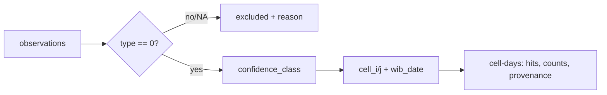

# Cell-Day Harmonization Method

Option 1 from [method-options](method-options.md) is implemented in
`src/eyes_on_karhutla/harmonization.py` and tested in `tests/test_harmonization.py`. It is checked on
real data in `notebooks/02_compare_modis_viirs.ipynb`. It gives the two sensors a **common unit**, but
on its own it does **not** make them comparable (see Findings). Comparability over time comes from
per-platform flags plus side-by-side series in [activity](../activity/summary.md).

## Decisions
| Question | Decision | Rationale |
|---|---|---|
| Grid | 0.01° cells (`config.HARMONIZATION_GRID_DEG`), assigned by the detection centre | Close to MODIS nadir pixel size |
| Day | WIB calendar date nationwide (`config.HARMONIZATION_TZ = "Asia/Jakarta"`) | One national convention |
| FIRMS `type` | Keep `type == 0` only. Rows with another type get `non_vegetation_type`, rows with a missing type get `missing_type`. If the `type` column is absent, raise `ValueError` (NRT data has no `type`) | Excludes volcanoes, static sources and offshore detections |
| Platform | `platform` per detection: VIIRS from `source`, MODIS from `satellite` (`Terra`/`Aqua`); unknown gives `unknown_platform` | Series need a fixed constellation |
| Confidence | Keep all levels and add `confidence_class`. `low_conf_only` flag; `exclude_low_confidence=True` is an opt-in sensitivity check (`low_confidence` reason) | The scales differ across sensors |

## API
```python
from eyes_on_karhutla import harmonization
cell_days, excluded = harmonization.harmonize(obs)           # = prepare + to_cell_days
kept, excluded = harmonization.prepare(obs, grid_deg=0.01, exclude_low_confidence=False)
cell_days = harmonization.to_cell_days(kept, grid_deg=0.01)
```
- `prepare` adds `confidence_class`, `platform`, `cell_i`, `cell_j` (int grid indices) and `wib_date`.
  The platform maps live in `config` (`PLATFORMS`, `VIIRS_PLATFORM_BY_SOURCE`,
  `MODIS_PLATFORM_BY_SATELLITE`). MODIS NRT satellite codes are unverified.
- `cell_index` = `floor(round(coord / grid, 6))`. The rounding guards against float error
  (0.29 maps to 29, not 28). It floors correctly south of the equator (-0.001 maps to -1).
- `wib_date` rolls over at 17:00 UTC.

## Confidence mapping
| Sensor | low | nominal | high |
|---|---|---|---|
| MODIS (0–100) | < 30 | 30–79 | ≥ 80 |
| VIIRS | `l` | `n` | `h` |

The MODIS thresholds follow the FIRMS docs and still need re-confirming. An unparseable value gives NA,
and NA never counts as low. In the 2019 sample the low share is similar across sensors (about 7%), but the
high share is not (MODIS 34%, S-NPP 4%).

## Output contract (`to_cell_days`)
One row per `(cell, wib_date)` with at least one kept detection, sorted by cell, then date:

| Column | Type | Meaning |
|---|---|---|
| `cell_lat`, `cell_lon` | float | south-west corner of the cell |
| `wib_date` | `datetime.date` | WIB date |
| `modis_hit`, `viirs_hit` | bool | any MODIS / any VIIRS satellite |
| `terra_hit`, `aqua_hit`, `snpp_hit`, `noaa20_hit`, `noaa21_hit` | bool | per platform |
| `n_modis`, `n_viirs` | int | raw detection counts, for traceability only |
| `low_conf_only` | bool | every detection in the cell-day is low class |
| `source_record_ids` | list[str] | contributing ids |

Invariants:
- `len(kept) + len(excluded) == len(obs)`
- `sum(len(ids)) == len(kept)`

An active cell-day means at least one thermal anomaly was detected in that cell on that date. It is not a
count of fires, burned area or intensity.



## Findings (2019 sample; notebook 02)
- **The VIIRS/MODIS ratio does not stabilize.** On complete WIB dates, VIIRS has 5.6× as many active
  cell-days as MODIS (median; range 2.4–12.2, CV 0.33). Raw counts give 5.3× (1.7–10.3, CV 0.29). Grids up
  to 0.1° give the same result. The excess comes from VIIRS's higher **detection sensitivity**, not from its
  smaller pixels. The daily shape agrees (r ≈ 0.92).
- **Same-cell agreement depends on the grid.** 57% of MODIS cell-days have a VIIRS hit in the same cell at
  0.01°, 85% within the 3×3 neighbourhood, and 83% at 0.1°.
- **S-NPP and NOAA-20 are not redundant per cell.** 39% of VIIRS cell-days are NOAA-20 only. Combining
  them in `viirs_hit` adds a satellite from 2018 onward, so the VIIRS series is not consistent across
  2012–2017 vs. 2018 onward.
- **Low-only cell-days** are 7% overall and 0.2% when both sensors hit.

## Chosen follow-up
Side-by-side series with fixed constellations: `modis` (Terra + Aqua) and `viirs_snpp`. They are
never summed; see [activity](../activity/summary.md). Deferred: an overlap-year calibration
([method-options](method-options.md) Option 2) once multi-year data is pulled, and a
neighbourhood-based agreement metric.

## Limitations
- WIB in WITA/WIT areas: detections at 23:00–23:59 WIB fall on the next local date there.
- The ~00–01 WIB night pass lands on the next WIB date after the daytime pass.
- A UTC-bounded pull leaves the first and last WIB dates partial. They must be dropped or flagged
  `activity.wib_date_coverage` flags them.
- Each detection goes to the one cell containing its centre. MODIS pixels up to 4.8 km wide are not
  spread over neighbouring cells.

Related: [summary](summary.md) · [method-options](method-options.md) ·
[firms-sample-2019](../data/firms-sample-2019.md) · [observation-schema](../data/observation-schema.md)
