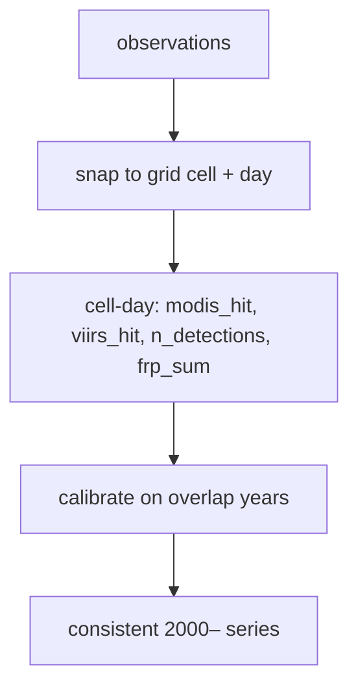

# Harmonization Method Options

**Option 1 is implemented** ([cell-day-method](cell-day-method.md)), but it does not equalize the
sensors. Current approach: side-by-side fixed-constellation series ([activity](../activity/summary.md)).
Option 2 (calibration) is deferred until multi-year data exists.

1. **Common grid and day ("fire-active cell-days").** Snap all detections to a shared grid
   (e.g. 0.01° ≈ 1 km, near MODIS resolution) per UTC or local day. A cell-day is active if any
   sensor detected it. Store per-sensor flags so provenance is kept. *Pro:* this removes VIIRS's
   resolution-driven overcounting. *Con:* it loses sub-cell detail, and the choice of grid has to
   be justified.
2. **Overlap-period calibration.** Use the years when both sensors were operating (2012–) to fit
   a ratio or regression of VIIRS against MODIS activity per region and season. Then extend a
   MODIS-equivalent series back to 2000. *Pro:* a long history. *Con:* the ratio may vary with
   land cover, peat and cloud cover.
3. **Spatio-temporal clustering.** Merge detections within a distance and time window into
   "detection clusters". *Con:* the clusters are easy to mislabel as fires and need careful
   wording.

Evidence from the 2019 sample ([firms-sample-2019](../data/firms-sample-2019.md)):
- The daily VIIRS/MODIS count ratio ranges from 1.07 to 10.3 (median 5.0). A constant factor
  fails, which weakens a simple Option 2 and favours Option 1, possibly calibrated per region
  and season.
- Option 1 result: the ratio stays at about 5.5× on cell-days at any grid from 0.01° to 0.1°. The
  difference comes from sensor sensitivity, not pixel count.
- S-NPP and NOAA-20 daily totals correlate (r = 0.98), but 39% of VIIRS cell-days are NOAA-20 only,
  so the two satellites are not redundant per cell.

Resolved questions (see [cell-day-method](cell-day-method.md)): WIB day, keep all confidence
levels with a low-only flag, and per-sensor presence flags so revisits are not double-counted.



```python
# Option 1 sketch (not implemented):
# obs["cell"] = (obs.latitude // 0.01, obs.longitude // 0.01)
# cell_days = obs.groupby(["cell", obs.acq_datetime.dt.date, "sensor"]).size().unstack()
```

Related: [summary](summary.md)
