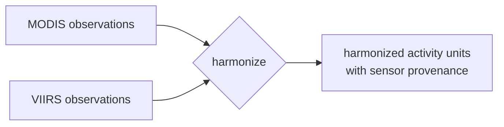

# Harmonization

**Status:** cell-day method implemented and tested (`harmonization.py`). It produces 0.01° active
cell-days on WIB dates, keeps `type == 0` only, and keeps all confidence levels with a low-only flag.
On the 2019 sample it gives a common unit with provenance, but VIIRS still has about 5.5× as many
active cell-days as MODIS, because VIIRS is more sensitive. So activity is reported as
side-by-side series with fixed constellations ([activity](../activity/summary.md)); calibration is
deferred. See [cell-day-method](cell-day-method.md); alternatives are in
[method-options](method-options.md).

## Hard constraints (from AGENTS.md)
- Concatenating MODIS and VIIRS rows is not harmonization.
- A detection is not a fire, and sensors do not map one-to-one to fires.
- Account for resolution (about 1 km vs. 375 m), overpass times, confidence scales and per-sensor
  availability (MODIS 2000–, S-NPP 2012–, NOAA-20 2018–).
- Keep `sensor` and `source_record_id` traceable through the harmonized output.



```python
cell_days, excluded = harmonization.harmonize(obs)  # see cell-day-method.md
```

Related: [observation-schema](../data/observation-schema.md)
