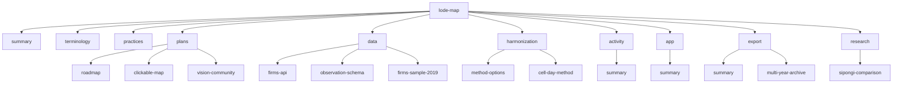

# Lode Map

- [summary.md](summary.md): living project snapshot
- [terminology.md](terminology.md): domain language
- [practices.md](practices.md): conventions and invariants
- plans/
  - [roadmap.md](plans/roadmap.md): priorities and next TODOs
  - [clickable-map.md](plans/clickable-map.md): click-a-province concept, spike results, boundary data
  - [vision-community.md](plans/vision-community.md): future community reports + moderation vision
- data/
  - [summary.md](data/summary.md): data sources overview
  - [firms-api.md](data/firms-api.md): FIRMS area API contract and ingestion
  - [observation-schema.md](data/observation-schema.md): normalized observation schema
  - [firms-sample-2019.md](data/firms-sample-2019.md): Aug–Oct 2019 sample facts and implications
- harmonization/
  - [summary.md](harmonization/summary.md): status and constraints
  - [cell-day-method.md](harmonization/cell-day-method.md): chosen method, decisions and output contract
  - [method-options.md](harmonization/method-options.md): candidate methods (Option 1 chosen)
- activity/
  - [summary.md](activity/summary.md): side-by-side series, coverage, period aggregation
- app/
  - [summary.md](app/summary.md): Streamlit page, pipeline orchestration, visual conventions, verification
- export/
  - [summary.md](export/summary.md): province assignment, data-product contract v1 (multi-year), exporter CLI
  - [multi-year-archive.md](export/multi-year-archive.md): raw archive + pull, run_archive, status functions, full-export results
- research/
  - [sipongi-comparison.md](research/sipongi-comparison.md): SiPongi+ feature comparison (pending)
- tmp/: git-ignored session scraps

