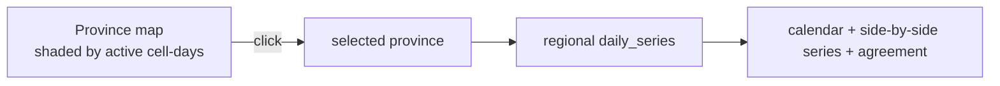

# Plan: Clickable Indonesia Map → Regional Burning History

**Status:** decided. The public map is built as a **separate JS package (option C)**
(`web/` in the monorepo, MapLibre), not in Streamlit; see AGENTS.md §13.1. The Streamlit/folium
prototype (`spikes/province_click.py`) showed folium *can* do click-to-select. It was rejected
because the owner wants a rich, gamified UI (fly-in zoom, WebGL dots, per-dot history,
contributions), which fights Streamlit's rerun model. This repo's job is to **export data products**
for the web project. The granularity (provinces vs. island groups) is not yet confirmed.

## Concept
The app opens on a map of Indonesia with provinces shaded by activity. Clicking a province opens its
burning history: a multi-year calendar, the MODIS and VIIRS S-NPP series side by side, peak
seasons, coverage and sensor agreement. The existing calendar, map and method views become the
detail views for the selected region.



## Prototype questions
1. Does a streamlit-folium click on a province shape return the province reliably?
2. Is the click → rerun → panel update fast enough, and does the map keep its zoom?
3. What share of cell-days falls outside the simplified province shapes (coastal or offshore)?

If the answers to 1 or 2 are bad, try a Plotly choropleth with `on_select`. Consider a custom JS
front end only if both fail.

## Prototype results (2026-10-21, headless Chrome via Playwright)
1. **Click → province: reliable.** `st_folium(..., returned_objects=["last_active_drawing"])`
   returns the clicked feature's properties (`shapeName`). A transparent `folium.GeoJson` click layer
   sits over a `folium.Choropleth`.
2. **Latency is about 0.8 s** from click to panel without `st.rerun()`, and about 1.3–1.6 s with
   the extra `st.rerun()` used to sync the selection outline. The script itself runs in about 0.3 s
   when cached.
3. **Zoom and pan are kept across clicks** when the map has a fixed `key` and the selection
   outline goes through `feature_group_to_add` (a dynamic layer; the base map is not rebuilt).
4. **The selected outline persists** (orange `#eb6834`, weight 3).
5. **Unassigned cell-days: 6.4%** fall outside the simplified shapes (other countries in the bbox,
   coast, sea).

```python
selected = folium.FeatureGroup(name="selected")   # rebuilt each run; the map is not
out = st_folium(m, key="map", feature_group_to_add=selected, returned_objects=["last_active_drawing"])
name = (out or {}).get("last_active_drawing", {}) and out["last_active_drawing"]["properties"]["shapeName"]
```

Lessons:
- folium `tiles="cartodbpositron"` now shows an **"API KEY REQUIRED" watermark**. Use
  `"OpenStreetMap"` (attribution shown; light use only under the OSM tile policy) or another
  keyless provider. Plotly `map_style="carto-positron"` in the main app is unaffected.
- The default view at zoom 5 crops Sumatra. Use `fit_bounds` on the Indonesia extent.
- Leaflet draws a browser focus rectangle around the clicked path. Hide it with CSS
  (`path:focus {outline: none}`).
- A choropleth total (all dates) differs slightly from the panel total (complete dates only), e.g.
  Central Kalimantan 14,577 vs. 14,551. The real build must use one definition.
- Choropleth fill at 0.7 opacity hides the base map when zoomed in. Lower it or fade with zoom.

## Boundary data (verified 2026-10-21 via the geoBoundaries API)
- Source: geoBoundaries gbOpen `IDN/ADM1`, built from **OpenStreetMap (Wambacher)**.
- **Licence: ODbL 1.0.** Attribution is required, and derived boundary data we share must stay
  under ODbL.
- It has **34 provinces (year represented 2017)**. Current Indonesia has 38 provinces, after the
  2022 Papua splits. A newer or official source (e.g. BIG) is needed before the real build.
- File: `data/raw/boundaries/geoBoundaries-IDN-ADM1_simplified.geojson` (3.4 MB, EPSG:4326, not
  committed). Fields are `shapeName`, `shapeISO` and `shapeID`.

```python
import geopandas as gpd
prov = gpd.read_file("data/raw/boundaries/geoBoundaries-IDN-ADM1_simplified.geojson")
```

## Needed in this repo for the web project
- ✅ Region assignment and the v1 exporter: see [export](../export/summary.md).
- Multi-year pull (2012–) so "history" means more than one season.
- A SiPongi+ check: it reportedly has province filters and charts, so the claimed difference must
  be the harmonized multi-year per-region calendar, and it must be verified.

Related: [roadmap](roadmap.md) · [app](../app/summary.md) · [activity](../activity/summary.md)
