# Roadmap

The order follows the AGENTS.md priorities. Status reflects the current repo.

| # | Priority | Status |
|---|----------|--------|
| 0 | SiPongi+ research and feature comparison | ⏳ not started |
| 1 | Data foundation (ingestion, preprocessing, real sample) | 🟡 Aug–Oct 2019 sample pulled and explored; no boundary clipping yet |
| 2 | Harmonization method | ✅ cell-days + platform flags ([cell-day-method](../harmonization/cell-day-method.md)); calibration deferred |
| 3 | Burning activity calendar | 🟡 weekday × week calendar per series for one season; multi-year view pending |
| 4 | Streamlit app (internal tool) | 🟡 calendar, agreement map, method tab ([app](../app/summary.md)); the public UI is the `web/` package |
| 5 | Anomaly analysis and extras | ⏳ |

## Next TODOs
0. Public product = JS package `web/` in the same monorepo (AGENTS.md §13.1). The exporter
   writes contract v1 (multi-year, [export](../export/summary.md)); the archive holds
   2012-01-20 → 2026-06-30 and a full export validates. Next on the data side:
   - optionally extend MODIS/S-NPP to 2026-07-31 once NOAA-20 catches up (`archive pull --end`);
   - Stage 2 publishing (`docs/architecture.md` §4), as a path-filtered CI job in the monorepo.

   Still to decide: the boundary source (34 vs. 38 provinces), data hosting and licence.
1. Research SiPongi+ before presenting the app as differentiated (the comparison table is still
   unverified).
2. Verify Terra/Aqua end-of-life and orbit drift, and S-NPP status, before relying on series past
   about 2020 (and 2026 for S-NPP).
3. Cache processed cell-days (parquet) so the app doesn't rerun the pipeline on multi-year data;
   add a year × month calendar view.
4. Get Indonesian province boundaries (source and license to be decided) to clip the bbox.
5. Check the `/api/data_availability/` endpoint for per-source date coverage.

```mermaid
gantt
    dateFormat X
    axisFormat %s
    section Foundation
    Real sample + EDA      :a1, 0, 2
    SiPongi+ research      :a2, 0, 2
    section Core
    Harmonization          :b1, after a1, 3
    Activity calendar      :b2, after b1, 2
    Streamlit integration  :b3, after b2, 2
```



```python
from datetime import date
from eyes_on_karhutla import ingestion, config
raw = ingestion.fetch_area("VIIRS_SNPP_SP", config.INDONESIA_BBOX, date(2019, 9, 1), date(2019, 9, 30))
ingestion.save_raw(raw, "viirs_snpp_sp_2019-09")
```
