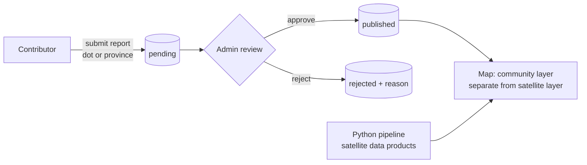

# Vision: Community Platform (future)

**Status:** a long-term direction from the project owner (2026-10-21), written into AGENTS.md §13.2
and the web project's AGENTS.md §10. Not designed or built. The core deliverable stays the
harmonized MODIS–VIIRS history.

## The idea
In the future, the site becomes an open, community-driven platform:
- Anyone can contribute **code or data** to the repo.
- **Local residents** can click a dot or province and post a situation update.
- **Remote contributors** can attach findings from social media to a dot or province.
- **Nothing goes live immediately.** Every submission enters a moderation queue, and an admin
  approves it before it is published.

## Implications (agreed direction, details undecided)
- **Front end (decided):** a separate JS package, `web/` in the monorepo (MapLibre), with its
  own AGENTS.md at `../web/AGENTS.md`. See [clickable-map](clickable-map.md).
- **Two contribution channels:**
  - GitHub (PRs and issues) for code and data. It is transparent and free, but too hard for
    residents.
  - An in-app form with a backend and moderation queue for situation reports.
- **Backend candidate:** a managed Postgres/PostGIS service with auth and row-level security, so
  `pending` rows are never publicly readable. Not chosen yet.
- **The Python pipeline is unchanged.** It exports satellite data products. Community reports never
  alter satellite-derived metrics.

## Invariants to keep (from AGENTS.md §7, §9 and the owner's requirement)
- No submission is public without admin approval.
- Community reports are a **separate, labelled layer**: "community report, unverified". They are
  never merged into detection counts.
- Admin approval means "meets publishing guidelines", **not** "verified true". The UI must say so.
- The site is not an emergency channel. It points people to official channels.
- Every report keeps who approved it, when, its source link (for social-media findings), and its
  observation time vs. submission time.

## Open risks to design for
- **Personal safety and privacy:** minimal personal data, no exact home locations shown publicly,
  photos with faces or plates blurred, and compliance with Indonesia's personal data protection
  law (to be verified).
- **Legal and defamation:** reports blaming named people or companies for fires. Guidelines needed;
  legal advice needed.
- **Misinformation and spam:** rate limits, a moderation workload plan, and multiple admins.
- **Copyright:** store links to social-media posts plus a short summary, not copies.
- **Accessibility:** Bahasa Indonesia first, low-bandwidth mobile, and possibly WhatsApp intake
  later.
- **Open-source governance:** licences (code vs. data, compatible with ODbL boundaries and FIRMS
  terms), CONTRIBUTING, code of conduct, admin roles.

Related: [roadmap](roadmap.md) · [clickable-map](clickable-map.md)
