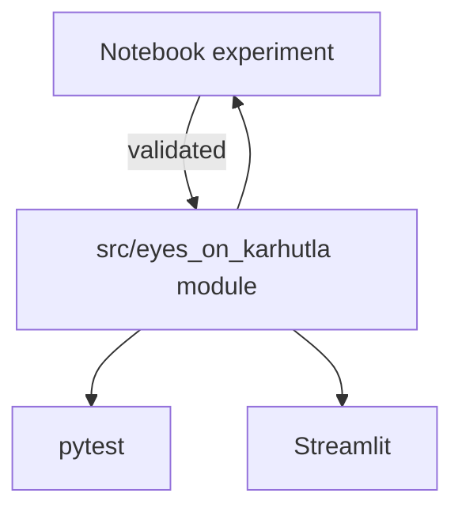

# Practices

## Architecture
- Science and business logic lives only in `src/eyes_on_karhutla/`. Notebooks and `app.py` import it.
- `app.py` handles UI and orchestration only. Expensive calls go through `st.cache_data`.
- Notebooks are for exploration. Validated logic moves into a module and gets a test.

## Data integrity
- Never drop rows silently. `preprocessing.normalize` returns `(observations, excluded)`, and each
  excluded row carries an `exclusion_reason`.
- Keep the original FIRMS columns (`satellite`, `confidence`, brightness fields) unchanged. Derived
  fields are added next to them.
- Every row carries `source`, `source_ref` and `retrieved_at`. API URLs are stored with the
  MAP_KEY replaced by `<MAP_KEY>`.
- Secrets never reach logs or errors: wrap any HTTP library exception and re-raise with the
  redacted URL `from None` (see `ingestion._get`). Test it with a key string that must not appear.
- Keep observation counts, FRP and burned area separate.

## Data contract with `web/`
- The export format (`export.SCHEMAS`, `SCHEMA_VERSION`) is a contract with the web package
  (`../web` in the monorepo). **Any change to exported files must, in the same step (ideally the
  same pull request), update:**
  - `lode/export/summary.md` (this package);
  - `docs/README.md` §3 if the layout changes;
  - `../web/AGENTS.md` §6 (its short summary only; it defers to the schemas).
- Edit only §6 of the web package's AGENTS.md. Its lode belongs to its own agent: tell the user
  what changed so that agent can update it.
- Additive changes keep `1.x`. Breaking changes bump the major version and go to a new `v2/` folder.
- Lesson: the web AGENTS.md once described a proposed format (row-per-date daily, a
  `viirs_noaa20` cell flag) that the exporter never wrote. The web agent caught it. Never write a
  proposal into the other package's instructions without a follow-up to reconcile it.

## Code conventions
- Python 3.12, managed with `uv`. Run `uv run pytest` before claiming anything is done.
- Read `acq_time` and `confidence` as strings so leading zeros and `l/n/h` survive.
- Tests use fake HTTP sessions (`FakeSession` in `tests/test_ingestion.py`) and never the live API.
- Label synthetic or test data clearly.

## Dev workflow
- REPL-driven: `uv run ipython` or `uv run jupyter lab`, then `%load_ext autoreload` and
  `%autoreload 2`. Import modules, not functions (`from eyes_on_karhutla import preprocessing`), so
  reloads take effect.
- Run one test with `uv run pytest tests/test_x.py::test_name`. Use `-k <pattern>`, `-x` or `--pdb`.
- Run every `uv` command from `pipeline/` (where `pyproject.toml` is). `config.PROJECT_ROOT` is
  `pipeline/`, so `data/` and `.env` live there.
- `.venv` can't be moved, because launcher scripts hard-code the interpreter's absolute path. If the
  project folder is renamed or moved, rebuild it with `rm -rf .venv && uv sync`. The symptom is
  `Failed to spawn: ipython ... No such file or directory`.

```python
obs, excluded = preprocessing.normalize(raw)
assert len(obs) + len(excluded) == len(raw)   # invariant: nothing silently lost
```



Related: [data/observation-schema](data/observation-schema.md)
