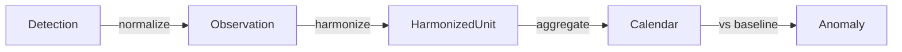

# Terminology

- **Eyes on Karhutla**: the project name. The distribution is named `eyes-on-karhutla` and the import package is `eyes_on_karhutla`, because Python package names can't contain hyphens.
- **Karhutla**: *kebakaran hutan dan lahan*, Indonesian for forest and land fires.
- **Hotspot / titik panas**: a satellite pixel flagged as a thermal anomaly. It is not a confirmed fire.
- **Detection**: one FIRMS row (one pixel, one overpass).
- **FIRMS**: NASA Fire Information for Resource Management System, our primary data source.
- **MAP_KEY**: personal FIRMS API key, stored in `.env` as `FIRMS_MAP_KEY` and never committed.
- **MODIS**: sensor on Terra and Aqua (2000–). Pixels are about 1 km at nadir. Confidence is 0–100.
- **VIIRS**: sensor on S-NPP (2012–), NOAA-20 and NOAA-21. Pixels are 375 m. Confidence is l/n/h (low, nominal, high).
- **SP / NRT**: FIRMS *standard processing* (science-quality archive) vs. *near real-time* products.
- **Source**: a FIRMS product name such as `VIIRS_SNPP_SP`. One source maps to one `sensor` family.
- **FRP**: fire radiative power in MW. It is not burned area and it is not a count.
- **scan / track**: pixel dimensions in km. They grow toward the edge of the swath.
- **Harmonization**: a documented method that makes MODIS and VIIRS activity comparable over time. Concatenating rows is not harmonization.
- **Active cell-day**: a 0.01° grid cell with at least one kept (`type == 0`) detection on a WIB date. It is the harmonized common unit, not a fire count.
- **confidence_class**: low/nominal/high derived from MODIS 0–100 (<30, 30–79, ≥80) or VIIRS l/n/h. The names match across sensors but the meaning doesn't.
- **Platform**: an individual satellite (`terra`, `aqua`, `snpp`, `noaa20`, `noaa21`). It is finer than `sensor`.
- **Series**: a fixed set of platforms counted as one activity series (`modis`, `viirs_snpp`, `viirs_all`). Series are shown side by side and never summed.
- **Complete WIB date**: a WIB date whose full 24 h falls inside the UTC pull range. The first and last dates of a pull are partial.
- **province_id**: ISO 3166-2 code from the boundary file (e.g. `ID-KT`, Central Kalimantan). It is the stable region key in exports.
- **cell_id**: `"{i}_{j}"`, the integer 0.01° grid indices of a cell. It stays stable while the grid is unchanged.
- **Outside provinces**: cell-days whose cell centre is in no province polygon (sea, coast, neighbouring countries). They are reported, never dropped.
- **Data products (contract v1)**: the schema-validated multi-year files `export.py` writes for the web app (manifest, provinces, Indonesia monthly, per-province daily, monthly and per-year cells).
- **Status (complete / partial / missing)**: coverage of a WIB date, month or year in the exports. Missing values are `null`, never 0.
- **Monorepo**: `eyes-on-karhutla`, with this Python package in `pipeline/` and the public web app in `web/`.
- **Activity calendar**: a harmonized activity metric aggregated by day, week, month or year for a region.
- **Baseline / anomaly**: the historical reference for a period and region, and the documented deviation from it.
- **SiPongi+**: the Indonesian Ministry of Forestry's fire information platform and the existing system we compare against. Data taken from it must cite "SIPONGI KEMENHUT".
- **Lode**: this `lode/` knowledge base.



```python
from eyes_on_karhutla.config import FIRMS_SOURCES
FIRMS_SOURCES["VIIRS_NOAA20_SP"]  # -> "VIIRS"  (source -> sensor family)
```
