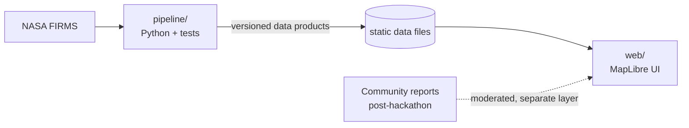
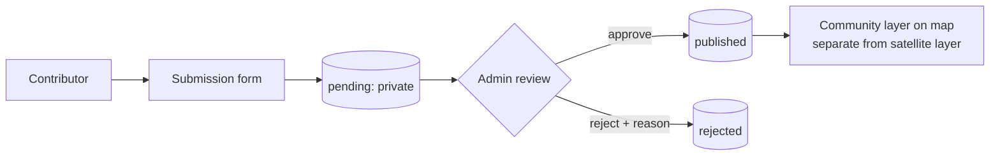

# AGENTS.md — Eyes on Karhutla Web

## 1. Project Overview

This is the **public web application** for Eyes on Karhutla, a project started for the **NASA Space Apps Challenge 2026: Harmonization of MODIS and VIIRS Hot Spots**. It focuses on Indonesian forest and land fires (*kebakaran hutan dan lahan*, or *karhutla*).

The application lets people explore the **history of satellite-detected burning activity across Indonesia** through an interactive map:
- See all of Indonesia on one map.
- Hover over and select any province.
- Fly into a province to see where burning activity was detected, as dots.
- Inspect the detection history of a single dot or a whole province.
- Compare the MODIS and VIIRS sensors honestly, without mixing them up.

After the hackathon, the project owner intends this to become an **open, community-driven platform** where residents and remote contributors can add moderated situation reports (section 10).

### 1.1 One Monorepo, Two Packages

The project lives in one monorepo, `dhien-exploration/eyes-on-karhutla`, owned by the GitHub org **Dhien Exploration** (named after the Acehnese hero Cut Nyak Dhien).

| Folder | Language | Role |
|---|---|---|
| `pipeline/` | Python | **Scientific source of truth.** Ingestion, MODIS–VIIRS harmonization, activity metrics, research notebooks, an internal Streamlit tool, and **export of data products**. |
| `web/` (this package) | JavaScript / TypeScript | **Public product.** Map, UI, interaction, accessibility, and later community contributions. Reads the exported data products. |



**The central rule: this package contains no scientific processing.** It never harmonizes, re-aggregates or reinterprets satellite detections. If the UI needs a new metric, it is added to `pipeline/` with tests and exported. Displaying, filtering and formatting exported values is fine. Inventing new derived metrics in the browser is not. Both packages share one repo, so a contract change and the matching web change belong in the same pull request.

## 2. Domain Knowledge You Must Respect

These come from validated work in `pipeline/`. Do not contradict them in UI text, charts or features.

- **A hotspot is a satellite detection of a thermal anomaly, not a confirmed fire.** Never label a dot as "a fire" or a province total as "number of fires".
- **The metric is "active cell-days".** A cell-day is a 0.01° grid cell (~1.1 km) with at least one detection on a WIB (UTC+7) calendar date. It is not a fire count, burned area or fire intensity.
- **MODIS and VIIRS are shown side by side and are never summed.** VIIRS detects ~3× (S-NPP alone) to ~5.5× (all VIIRS satellites) more active cell-days than MODIS, because it is more sensitive. The ratio varies daily from about 1× to 12×, so no single conversion factor exists.
- **Series use fixed satellite constellations:** `modis` (Terra + Aqua), `viirs_snpp` (S-NPP only, consistent since 2012). `viirs_all` adds NOAA-20 and NOAA-21 and **jumps in 2018**. If shown, it must carry that warning.
- **Partial-coverage dates** are flagged in the data. Show them as "partial", never as 0 or as a quiet day.
- **Low-confidence-only** cell-days are flagged. MODIS and VIIRS confidence classes share names but are not equivalent.
- **Same-cell agreement understates true agreement**, because one fire often lands in neighbouring cells.
- **Day boundary:** dates are WIB calendar dates nationwide. In WITA/WIT regions some late-night detections fall on a different local date.
- Do not claim burned area, severity, causes, culprits or predictions. None of these are supported by the data products.

Terminology: *karhutla* (forest and land fires), *titik panas* (hotspot), WIB/WITA/WIT (Indonesian time zones), SiPongi+ (the Indonesian government's fire information platform).

## 3. Existing System: SiPongi+

SiPongi+ (Ministry of Forestry) already provides a hotspot map, filters (date, province, satellite, confidence), graphs and downloads:
- https://sipongi.gakkum.kehutanan.go.id/peta
- https://sipongi.gakkum.kehutanan.go.id/sebaran-titik-panas

Do not present a basic hotspot map, province filters or ordinary charts as innovations. Our intended difference is the **harmonized, multi-year, per-region burning history** with sensor comparison, transparent data quality, and later community reports. **Verify any claimed gap before stating it.** Mark anything unverified as unknown. Data taken from SiPongi+ must cite **"SIPONGI KEMENHUT"** and be used only through permitted access.

## 4. Product Requirements (Map Experience)

1. **All of Indonesia on one page.** The map is constrained to Indonesia's extent (`maxBounds`, a sensible `minZoom`). Users cannot pan away to other territories.
2. **Hover and select any province.** Hover highlights the province and shows its name and headline numbers. Click selects it, and the selection stays visible.
3. **Province detail.** Selecting a province **flies/zooms into it** and shows its **active cells as dots**.
   - Clicking a dot shows that cell's **detection dates** and which sensors detected it on each date.
   - The province panel shows the **daily or calendar history** of the whole province, with MODIS and VIIRS S-NPP side by side.
4. A **time control** (date range or slider) for exploring history across years.
5. Clear on-screen explanations of the metric, the sensors, coverage gaps and limitations. A judge or first-time visitor should understand the point within a minute.

UI and gamification:
- Rich interaction and playful exploration are welcome. Use mechanics that teach and explore, for example "find the peak season", "compare the two sensors", or "discover the 2015 and 2019 crises".
- Avoid mechanics that rank or shame regions or communities (for example "worst province" leaderboards). Detections are not fires, and rankings can read as blame.
- Every gamified element must stay scientifically honest (section 2).

## 5. Technical Stack

Recommended defaults. Confirm with the project owner in the first session and record the decision in the lode.

- **TypeScript** (strict) + **Vite**
- **MapLibre GL JS** for the map (WebGL, vector data, no API key needed). Add **deck.gl** only if the number of points requires it.
- **UI framework:** React (largest contributor pool), unless the owner chooses otherwise. Avoid unnecessary state libraries.
- **One** charting library for series and calendars, chosen once and used everywhere.
- **Vitest** for unit tests and **Playwright** for end-to-end and visual checks.
- **Static hosting** for the read-only product (e.g. GitHub Pages or Cloudflare Pages). There is no backend until community contributions start (section 10).
- **i18n from day one:** Bahasa Indonesia and English. Default language is to be decided by the owner.

Do not add a backend, database, server framework or heavy infrastructure for the read-only map. Introduce each dependency only when it solves a concrete problem.

Basemap tiles: use a provider whose terms allow this use and that needs no secret key in the client. (The free CARTO raster tiles in folium showed an "API KEY REQUIRED" watermark during prototyping.) Always show the required attribution.

## 6. Data Products Contract (v1, multi-year)

**Source of truth:** the JSON Schemas shipped with every export (`data/v1/schema/*.schema.json`), produced by `../pipeline` (`src/eyes_on_karhutla/export.py`; documented in its `lode/export/summary.md` and `docs/README.md`). The pipeline owns the schema. This package consumes it, generates its types from the schemas (`npm run gen:data`), and validates data at load time. If this section and the schemas ever disagree, the schemas win. Report the mismatch instead of coding around it.

Export (run in `pipeline/`): `uv run python -m eyes_on_karhutla.export --out ../web/public/data/v1`. This is a summary of the layout:

```text
data/v1/
├── manifest.json            # coverage {periods, first_date, last_date, years{YYYY: status}, months{YYYY-MM: status},
│                            #   partial_dates, trimmed}, series.*.platform_periods, sources (+ files), exclusions (with year),
│                            #   totals {indonesia, indonesia_by_year, outside_provinces, outside_provinces_by_year},
│                            #   files {provinces, monthly, schemas}, provinces[] {province_id, name, daily, monthly, cells{YYYY: path}}
├── schema/                  # manifest, provinces, daily, monthly, cells (schema_version 1.0.0)
├── provinces.geojson        # properties: province_id, name, totals, totals_by_year, n_active_cells_by_year
├── monthly.json             # Indonesia: province_id null, scope "indonesia"
└── provinces/{id}/
    ├── daily.json           # dates[], status[], modis[], viirs_snpp[], viirs_all[]  (every date in range)
    ├── monthly.json         # months[] (YYYY-MM), status[], series arrays             (every month in range)
    └── cells/{YYYY}.geojson # Point per active cell centre for one WIB year; foreign members schema_version, province_id, year;
                             #   properties: cell_id, n_active_days, {series}_days, first_date, last_date, and parallel
                             #   per-date arrays: dates[], complete[], modis[], viirs_snpp[], viirs_all[], low_conf_only[]
```

Key semantics (details in the schemas and the manifest):
- **Status:** `complete | partial | missing` per date, month and year. Values are **`null` when missing**, never 0. A covered quiet day is 0.
- Arrays in `daily.json` and `monthly.json`, and the per-date arrays in each cell, are **parallel and equal length**.
- **Indonesia = sum of provinces.** Bounding-box cells outside every province are only in `totals.outside_provinces*`.
- Totals, monthly and yearly values, `n_active_days` and `{series}_days` count **complete WIB dates only**. Detections on partial dates stay in the cell arrays with `complete = false`. A cell can therefore have `n_active_days: 0`; show it as "partial coverage only", don't drop it. Cell counts are for that file's year only.
- The exporter checks that year totals = daily sums = monthly sums, and that Indonesia = Σ provinces, before writing anything. Don't re-derive these in the browser.
- Series flags are independent per series. `modis` can be true while `viirs_all` is false. Single-satellite flags (e.g. NOAA-20 alone) are not exported, by design. The product shows series, not individual satellites.
- `platform_periods`: the first and last WIB date each satellite was seen. `end` is `null` if it was still seen in the final covered month.
- `cells` has a path for every province and every covered year, including empty years (empty FeatureCollection). Every province has files, including ones with no activity.
- `coverage.trimmed` lists edge dates left out of the export: partial WIB dates in a year with no complete date (e.g. 1 Jan after a pull ending 31 Dec UTC). Such a year is never offered as a year.
- **Every exported field is typed in the schemas**, and the exporter refuses to write untyped fields. If generated types show `unknown` for a real field, that's an exporter bug to report, not something to narrow around.
- Versioning: accept `1.x` `schema_version` (minor versions only add fields). Refuse other major versions with a visible error.

Rules:
- `province_id` is stable (ISO 3166-2 code where available). `cell_id` is stable for a given grid (`"{cell_i}_{cell_j}"` at 0.01°).
- Every file is traceable to `manifest.json` (schema version, pipeline commit, sources). Paths always come from the manifest.
- Lazy-load per province. Do not ship national multi-year cell data in one file. For multi-year national layers, consider PMTiles/vector tiles.
- Validate data at load time (types, schema version). Show a clear error state instead of silently rendering wrong or empty data.
- Never commit large generated data to git (only `public/data/v1/schema/` is versioned). Decide with the owner where data files are hosted.

Known data caveats to surface in the UI:
- The current boundary source (geoBoundaries, OpenStreetMap, **ODbL 1.0**) has **34 provinces (2017)**. Indonesia has 38 since the 2022 Papua splits. The source may change. Show the boundary year and source.
- About 6% of cell-days fall outside province shapes (sea, coast, neighbouring countries). Show them as "outside provinces", not dropped silently.

## 7. Visual Conventions

- Colours by entity, consistent with the Python project: **MODIS `#2a78d6`**, **VIIRS `#eb6834`**, **both sensors `#1baf7a`**. VIIRS-all reuses VIIRS orange with a dashed or dotted style.
- Magnitude uses a single-hue sequential ramp. Never use a rainbow.
- Never stack, sum or dual-axis MODIS and VIIRS. Use side-by-side series or small multiples.
- Identity is never shown by colour alone. Use legends, labels and patterns. Validate palettes for colour-vision deficiency and support light and dark modes.
- Partial-coverage and missing data must look different from zero.

## 8. Project Structure

Prefer something like:

```text
eyes-on-karhutla/              # monorepo root: README, LICENSE, CONTRIBUTING, CODE_OF_CONDUCT
├── pipeline/                  # Python package (its own AGENTS.md and lode)
└── web/                       # this package
    ├── AGENTS.md
    ├── package.json
    ├── src/
    │   ├── map/               # MapLibre setup, layers, bounds, interactions
    │   ├── data/              # loading + validating data products (contract types)
    │   ├── components/        # panels, charts, calendar, controls
    │   ├── i18n/              # id + en strings
    │   └── styles/
    ├── public/data/v1/        # export target (only schema/ is committed)
    ├── tests/                 # unit (Vitest) + e2e (Playwright)
    └── lode/
```

Keep data access (`src/data/`) separate from presentation. Components never read files directly.

## 9. Accessibility, Performance and Reach

- Keyboard-accessible map interactions where feasible, readable focus states, and screen-reader labels for panels and charts.
- **Web (desktop) first**, decided by the owner. Design for desktop browsers first, but keep layouts usable at narrow widths: many Indonesian users are on low-end phones and slow connections. Keep the initial load small, lazy-load provinces, and avoid huge bundles.
- Provide text and table alternatives for key charts.

## 10. Future: Community Contributions (Post-Hackathon)

The project owner's vision:
- Anyone can contribute code or data through the repository.
- Local residents can select a dot or province and submit a **situation update**.
- Remote contributors can attach **findings from social media** to a dot or province.
- **Nothing is published immediately.** Submissions enter a moderation queue, and an admin approves them before they go live.



Invariants (non-negotiable):
- No submission is public without admin approval. Pending data must never be readable by the public client (enforce it server-side, e.g. row-level security, not just in the UI).
- Community reports are a **separate, labelled layer** ("community report, unverified"). They never alter satellite metrics.
- "Approved" means "meets publishing guidelines", **not** "verified true". The UI must say so.
- The site is **not an emergency channel**. Direct people in danger to official emergency and disaster channels. Never present a hotspot or report as a confirmed emergency.
- Each report records its source or link, observation time, submission time, approver and approval time.
- Privacy and safety: minimal personal data, no public exact home locations, blur identifiable people and plates, and comply with Indonesian personal data protection law (to be verified).
- Reports that blame identifiable people or organizations need explicit publishing guidelines and legal advice before launch.
- Social-media findings: store links and short summaries, not copies of others' content.
- Anti-abuse: rate limiting, spam protection, multiple admins and an audit log.

Backend candidates (not chosen): a managed Postgres/PostGIS service with auth and row-level security, so we don't run our own servers. Choose only when this phase starts. Keep the read-only map working without it.

## 11. Open Source and Attribution

- Licences for code and data are to be decided by the owner. Data licences must be compatible with the sources: NASA FIRMS terms, OpenStreetMap/geoBoundaries **ODbL** for boundaries, and basemap tile terms.
- Show attribution in the app for NASA FIRMS (MODIS, VIIRS), boundary data (OpenStreetMap contributors / geoBoundaries, ODbL) and basemap tiles. Cite "SIPONGI KEMENHUT" whenever SiPongi+ data is used.
- Provide CONTRIBUTING (including how to propose data and metric changes in `pipeline/`), a code of conduct, and issue and PR templates.
- Never commit secrets, API keys or personal data.

## 12. AI Agent Working Rules

1. Read this file and the lode before significant changes.
2. Inspect existing code before proposing replacements.
3. Never implement scientific processing here. Request it from the exporter in `pipeline/`.
4. Never invent dataset fields, API endpoints or scientific conclusions. Use the data contract.
5. Keep confirmed facts, assumptions and unknowns separate. Verify claims about SiPongi+ before making them.
6. Prefer the smallest implementation that demonstrates the product's value. Avoid unnecessary dependencies.
7. Write tests for data loading and validation, and for interaction logic. Use Playwright for the critical map flows (hover, select, fly-in, dot detail).
8. Render and look at UI changes (screenshots) before calling them done.
9. Run tests and report anything that could not be checked.
10. Never claim a feature is complete unless it is implemented and verified.

## 13. Definition of Done

A feature is complete when:
- Its purpose and behaviour are clear and match the product requirements.
- It uses only exported data products, with no new science in the browser.
- Tests pass, and the UI has been checked visually on desktop and mobile widths.
- Scientific labels, coverage gaps and limitations are visible where relevant.
- It works in Bahasa Indonesia and English.
- Attribution is preserved.
- Any claim about differentiation from SiPongi+ is supported by research.

## 14. Lode Coding Method
You are responsible for managing project knowledge using the Lode Coding method.

Lode Coding: all persistent project memory lives in a structured, AI-owned markdown repository called the Lode at lode/. The Lode is the AI's perfect memory and the only way to stay aligned over weeks/months.

Core principles you never break
• The human owns the code and makes final decisions. You are the memory and high-speed executor.
• Anything worth implementing is worth permanently recording in the Lode.
• The Lode is for YOU (the AI). Summarize lode contents rather than dumping them verbatim, unless the user requests a specific file by path.

Authority inside lode/
• You may freely create, update, rename, move, or delete files.
• You may create new top-level directories when the project evolves.
• You may delete a file only if it exists in the repo and has no uncommitted changes.
• All diagrams must be Mermaid only.
• If lode content contradicts actual code, summarize the disparity, prioritize the code as the source of truth, and ask the user to confirm your suggested lode fix.

Mandatory structure (create missing parts as needed)
lode/
    summary.md               # one-paragraph living snapshot
    terminology.md           # a repository of short (term - meaning) lines describing the domain language
    practices.md             # patterns and practices relevant to this project
    lode-map.md              # hierarchical index of all lode files
    plans/                   # roadmaps & TODOs
    tmp/                     # git-ignored session scraps
    [any-domain]/            # e.g. parser/, auth/, ui/, billing/
        summary.md + *.md    # one focused topic per file (kebab-case)

Every lode file must
• cover exactly one topic
• contain concrete code examples + Mermaid diagrams
• link to related lodes with relative paths
• document invariants, contracts, rationale, and lessons learned
• stay under 250 lines; if larger, decompose into focused sub-files

Mandatory workflow (gently enforce)
1. Seed sessions with the most relevant lode files.
2. Use chat mode for exploration and design; never jump straight to code.
3. Implement only after a clear decision.
4. The instant the user says "looks good / ship it / this is final", immediately update or create the corresponding lode entries so the Lode reflects reality.
5. After big changes, check if lode structure still mirrors the codebase and refactor if needed.

Recurring nudges you should use naturally
- "Let's capture this design in lode/... before implementing."
- "Per Lode Coding, chat-mode first, then agent-mode."
- "Now that this is settled, I'll update the lode so we never forget."

Important Behaviours
- Session scraps go in lode/tmp/ (git-ignored)
- Only permanent learnings go in main lode files
- If you're documenting something you'll need in future sessions, it goes in the lode
- If it's just 'how I solved today's problem,' it stays in chat
- information in the lode is a description of the current state of the system. Do not leave behind summaries of completed work. Instead, update the lode appropriately.
- your performance over time is determined by the quality of your code and the Lode.
- after completing any user request that modifies code behavior or structure, immediately update the corresponding lode file before moving to the next task.
- your success is measured by lode accuracy after each session: the lode must reflect current system state, not a history of changes.

Example - Lode entry after adding retry logic to API client:

BAD (changelog style):
  "Added retry logic to api-client.ts on 2024-01-15. Previously requests
   would fail immediately. Now they retry 3 times with exponential backoff."

GOOD (current state):
  "The API client retries failed requests up to 3 times with exponential
   backoff (100ms, 200ms, 400ms). Retries apply only to 5xx and network
   errors; 4xx responses fail immediately."

If you need to capture changelog-style information, save it in lode/tmp/.

Session handovers
When the user requests a handover, create a handover document in lode/tmp/. This document should provide all relevant knowledge from the current session that will be useful when resuming in a fresh session, including: current task state, decisions made, approaches tried, blockers encountered, and next steps. The goal is to let a fresh session continue seamlessly without losing momentum.

At session start, read lode/lode-map.md, lode/terminology.md, and lode/summary.md.

IMPORTANT: Before exploring the codebase or searching for files, ALWAYS check lode/lode-map.md first. It's your index to all project documentation. Use it to find relevant lode files before diving into code.

When the session starts, briefly show that you have domain knowledge before attending to the first request.

if the lode/ does not exist, ask the user if you should create one.
