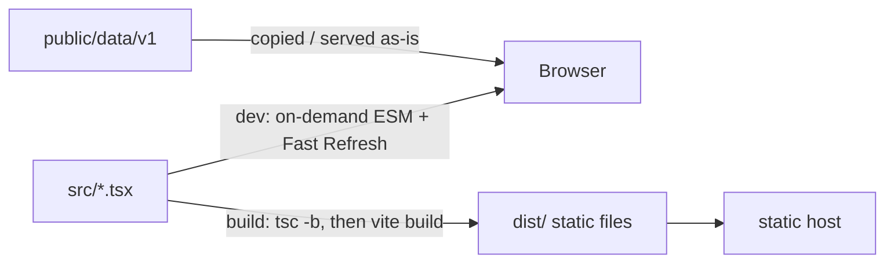

# Stack

Decided by the owner (2026-10-21): **TypeScript (strict) + Vite + React + MapLibre GL JS + uPlot**, with Vitest and Playwright for tests and oxlint for linting. Static hosting, no backend.

| Package | Version range | Role |
|---|---|---|
| vite | ^8.3 | dev server + production bundler |
| react, react-dom | ^19.3 | UI components and state |
| typescript | ~6.0 | type checking only (`tsc -b`, `noEmit`) |
| maplibre-gl | ^6.15 | WebGL map, OpenFreeMap basemap ([../map/summary.md](../map/summary.md)) |
| uplot | ^1.6 | the one charting library (installed, not wired yet) |
| vitest, jsdom, @testing-library/* | | unit/component tests |
| @playwright/test | | e2e flows + screenshots |
| oxlint | | lint (template default, replaces ESLint) |
| ajv, json-schema-to-typescript | | dev only: generate `src/data/generated/` from the data schemas |

## How Vite and React fit together
They do different jobs. **React** is the UI library: components, state, re-rendering. **Vite** is the build tool that turns `.tsx` source into something a browser runs.
- In dev (`npm run dev`), Vite serves `index.html` and sends each source file to the browser as a native ES module, transforming TS/JSX on demand. `@vitejs/plugin-react` adds JSX transform and **Fast Refresh**, so edits to a component hot-swap without losing state.
- In build (`npm run build`), `tsc -b` type-checks first (Vite itself strips types without checking). Then Vite bundles, minifies and hashes everything into `dist/` for static hosting.
- Files in `public/` (including `public/data/v1/`) are served as-is at `/`. That is why the app can `fetch("/data/v1/manifest.json")`.



## Entry points
- `index.html` (`lang="id"`) loads `src/main.tsx`
- `src/main.tsx` renders `<I18nProvider><DataProvider><App/></DataProvider></I18nProvider>` and imports `src/styles/index.css`
- `vite.config.ts` also holds the Vitest config (`jsdom`, `tests/setup.ts`, `tests/unit/**`)

## Scripts
`dev`, `build`, `typecheck`, `lint`, `preview`, `test`, `test:watch`, `test:e2e` (Playwright), `gen:data` (regenerate data types/validators), `check:data` (fail if they are stale)

TS projects: `tsconfig.app.json` (src, browser), `tsconfig.node.json` (vite.config.ts), `tsconfig.test.json` (src + tests, adds Node/Vitest/jest-dom types).

## Layout
```text
src/
  App.tsx              # page state + loading / error / ready layout
  components/          # LanguageSwitch, SeriesFigures, HoverCard, ProvincePanel, DataErrorState
  i18n/                # strings.ts, context.ts, I18nProvider.tsx
  data/                # loader, validation, generated contract types (see ../data/loader.md)
  map/                 # IndonesiaMap, basemap, geometry
  styles/index.css     # tokens + base styles
scripts/gen-data-contract.mjs
tests/setup.ts, tests/unit/, tests/unit/data/, tests/e2e/ (playwright.config.ts)
```

## Lessons
- `npm create vite` will not scaffold into a non-empty folder without prompting. The template was generated in a scratch folder and copied in.
- TypeScript 7 exists, but the Vite template pins `~6.0`. We stay on 6 until the toolchain moves.

Related: [../practices.md](../practices.md), [../data/data-products.md](../data/data-products.md)
