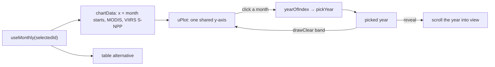

# Monthly Chart (`src/chart/monthly.ts`, `MonthlyChart`, `MonthlySection`)

The drawer section **"Aktivitas bulanan · {place}"** charts active cell-days per month over the whole export. It shows Indonesia (`monthly.json`) with no province selected, else the selected province (`provinces/{id}/monthly.json`), loaded with `useMonthly(selectedId)`. It sits right after the province figures. The design comes from [../plans/multi-year.md](../plans/multi-year.md).



## Honesty rules
- **MODIS and VIIRS S-NPP on ONE shared y-axis**: never stacked, summed or on two y-axes (AGENTS.md section 7). VIIRS sits ~3× higher, which is the honest picture. `viirs_all` is not charted.
- **Missing months are gaps** (`null` with `spanGaps: false`), never drawn at 0. **Partial months are hollow points** (`points.filter` returns `partialIndices`).
- The values are exported monthly totals (complete dates only), used as-is; nothing is summed in the browser.
- **Caveats shown under the chart:** detections ≠ fires; no detection ≠ no fire (clouds, thick haze); patterns, not causes; months differ in length (28–31 days).
- **Platform markers** (dashed vertical lines, listed in the caption) where a satellite of a charted series starts or stops *in the data* (`platform_periods`, first/last detection seen, not launch dates). Edges at the start or end of the range are skipped. The trial export has none.

## Interaction
- The **picked year is shaded** (a band drawn in uPlot's `drawClear` hook). Changing the year only calls `redraw`.
- **Clicking a month picks its year** (`u.cursor.idx` → `yearOfIndex` → App's `pickYear`). So the map colours, figures and dots follow the chart.
- **Long ranges scroll sideways** (`.monthly-chart__scroll`, `overflow-x: auto`). Each month is `MONTH_WIDTH` = 12 px (`plotWidth`), so 2012–2026 (175 months) is ~2,160 px in a ~310 px drawer. Short ranges fill the width and don't scroll. A muted hint ("Geser grafik ke kiri atau kanan…") shows only when it scrolls.
- **The picked year is scrolled into view** (`reveal`): centred, only if not already fully visible. Smooth on a year change, instant when the drawer's width changes (ResizeObserver, after uPlot has laid out; includes the first render). With "Semua tahun" it opens at the latest months.
- The live legend (uPlot) shows the hovered month, e.g. "September 2019 (parsial)", and both values, locale-formatted ("—" when missing).

## Rendering details
- x is in UTC seconds at each month's start (`monthStart`). The x ticks come from `monthTicks(monthly, monthWidth)`: every January (labelled with the year), plus every 6, 3 or 1 month(s), the densest step that keeps ≥ 30 px between labels (quarters at 12 px/month). uPlot's own time ticks skipped January ("Jun / Des / Jun"). **x labels are rotated 30°** (`rotate: 30`, axis `size: 44`).
- **y labels stay fixed while the chart scrolls.** uPlot keeps its y-axis (grid lines, a `Y_GUTTER` = 52 px gutter) but draws its labels in transparent ink. The `values` callback records the splits, and a `draw` hook writes them into an HTML column (`.monthly-chart__y`, glass background, outside the scroller) at `bbox.top + valToPos`. Labels are locale compact ("100 rb" / "100K"); 52 px fits "100 rb".
- **The legend is mounted outside the scroller** (`legend.mount`), so it stays visible.
- Colours come from the CSS tokens (`--c-modis`, `--c-viirs`, `--c-border`, `--c-muted`, `--c-surface` for hollow points, `--c-chart-year` for the band). The plot is rebuilt on theme or language change and resized with a ResizeObserver. Height is 200 px.
- The canvas is `aria-hidden`. The `<figure>` holds the caption, caveats and a `<details>` **table** (month, MODIS, VIIRS S-NPP, status; "—" for missing).
- Loading and error states (with retry) appear inside the section.

```ts
chartData(monthly)      // [x seconds[], modis (number|null)[], viirs_snpp (number|null)[]]
partialIndices(monthly) // [0] for Jan 2019 in the trial export
monthTicks(monthly, 12) // Jan, Apr, Jul, Oct of every year (12 px per month)
plotWidth(monthly, 310) // max(310, months × 12)
```

## Tests
- `tests/unit/monthly-chart.test.ts`: month starts / year span, nulls kept (no `viirs_all`), partial indices, year of index, tick density by px per month, `plotWidth`, platform markers inside the range only.
- `tests/unit/app.test.tsx` (MonthlyChart mocked, because uPlot needs a canvas): Indonesia then province series, click → year, table rows with partial/"tidak ada data" and "—".
- `tests/e2e/map.spec.ts`: canvas and legend; the chart scrolls and opens scrolled (to the default year); hovering the peak month (scrolled into view) shows both exported values; a click picks that month's year; the table has one row per month; province switch. Default-year expectations come from the manifest (`defaultYear()`), not hard-coded years.

## Lessons
- Playwright `getByRole(…, { name })` matches substrings. The new heading "Aktivitas bulanan · Seluruh Indonesia" broke lookups for "Seluruh Indonesia", so use `exact: true` for heading and region names.
- Scrolling the chart (or setting `scrollLeft`) doesn't move uPlot's cursor; `cursor.idx` updates on mousemove. In tests, move to the month before clicking.
- `reveal` must wait for layout: right after `new uPlot(...)` the scroller can't scroll yet, so the first reveal runs from the ResizeObserver in a `requestAnimationFrame`.
- Don't assign a ref during render (oxlint `react(refs)`). Update it in an effect declared before the effect that reads it.

Related: [../plans/multi-year.md](../plans/multi-year.md), [../ui/layout.md](../ui/layout.md), [../data/data-products.md](../data/data-products.md)
