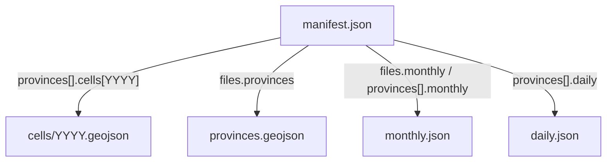

# Data Products (contract v1, multi-year)

Produced by `../pipeline` (Python, `src/eyes_on_karhutla/export.py`; its `lode/export/summary.md`). The web app reads **v1**, from `public/data/v1/` (~690 MB, **git-ignored except `schema/`**, which is versioned here as the contract; hosting not decided). The pipeline writes it there directly:

```bash
cd ../pipeline && uv run python -m eyes_on_karhutla.export --out ../web/public/data/v1   # then, in web/: npm run gen:data
```

**Source of truth: `public/data/v1/schema/*.schema.json`** (JSON Schema 2020-12, `schema_version` 1.0.0). Types and validators are generated from them ([loader.md](loader.md)). If anything here disagrees with the schemas, the schemas win. The owner decisions behind the layout are in [../plans/multi-year.md](../plans/multi-year.md). (This multi-year layout was called "v2" until 2026-11-14, when the old single-range v1 was deleted and the monorepo renamed it v1; the content is unchanged.)

```text
public/data/v1/
  manifest.json            # coverage periods + year/month status, series (+platform_periods), sources, totals, file index
  schema/{manifest,provinces,daily,monthly,cells}.schema.json
  provinces.geojson        # 34 polygons; totals, totals_by_year, n_active_cells_by_year
  monthly.json             # Indonesia monthly series (scope "indonesia", province_id null)
  provinces/{ID-XX}/daily.json           # every date in range + status, nullable counts
  provinces/{ID-XX}/monthly.json         # scope "province"
  provinces/{ID-XX}/cells/{YYYY}.geojson # one WIB calendar year
```

## Shapes
```ts
// manifest.json (selected)
{ schema_version: '1.0.0', day_convention, year_convention: 'WIB calendar year (1 Jan 00:00 to 31 Dec 23:59 WIB)',
  coverage: { periods: [{start, end}], first_date, last_date,
              years: { '2019': 'partial', '2020': 'complete' }, months: { '2019-01': 'partial', … },
              partial_dates: string[], trimmed: { dates, cell_days, note }, note },
  series: { modis | viirs_snpp | viirs_all: { label, platforms, default, platform_periods: { [platform]: { start, end | null } } } },
  sources: [{ source, required, utc_ranges, files: [{ file, start, end, raw_rows, kept_rows }] }],
  totals: { indonesia, indonesia_by_year: { [YYYY]: T }, outside_provinces, outside_provinces_by_year, note },
  provinces: [{ province_id, name, daily, monthly, cells: { [YYYY]: path } }],
  files: { provinces, monthly, schemas } }

// provinces.geojson feature.properties
{ province_id, name, totals: T, totals_by_year: { [YYYY]: T }, n_active_cells_by_year: { [YYYY]: number } }

// daily.json / monthly.json: parallel arrays, every date/month in range
{ schema_version, province_id /* monthly: string | null */, scope /* monthly only */, metric,
  dates | months: string[], status: ('complete' | 'partial' | 'missing')[],
  modis | viirs_snpp | viirs_all: (number | null)[] }   // null = missing, never 0

// cells/{YYYY}.geojson: one WIB year of active cells, plus members
{ type: 'FeatureCollection', schema_version, province_id, year: 2020, features: [{ geometry: Point, properties: {
  cell_id, n_active_days, modis_days, viirs_snpp_days, viirs_all_days, first_date, last_date,
  dates[], complete[], modis[], viirs_snpp[], viirs_all[], low_conf_only[] } }] }
```



## Invariants
- **"Indonesia" = the sum of the provinces.** Bounding-box cells in no province are `outside_provinces`, shown apart and never added in.
- **Missing ≠ zero:** daily/monthly values are `null` with status `missing`. A month or year is `partial` unless all its days are complete (or all missing). Values sum complete dates only.
- Totals and `*_days` count **complete WIB dates only**. Partial dates stay in the cell arrays with `complete = false`. A cell can have `n_active_days: 0` (partial-only).
- **Every province × covered year has a cells file** (an empty FeatureCollection when inactive). Each file states its `province_id` and `year`.
- `platform_periods` = first/last kept detection **seen in the data** (not launch dates). A platform never seen is absent.
- A date is covered only when every **required** source (MODIS_SP, VIIRS_SNPP_SP) covers it. NOAA-20/21 are optional and only feed `viirs_all`.
- Asserted by the pipeline before writing: per province × year, `totals_by_year` = Σ complete daily = Σ monthly; Indonesia monthly = Σ province monthly; Indonesia + outside = the bounding box.
- Arrays in daily, monthly and each cell are parallel and equal length (checked by the web loader).
- MapLibre stringifies array properties: read cell details from the loaded JSON (`indexCellRecords`), never from a queried map feature.
- `cell_id` holds the cell's lower-edge grid indices (`-107_10256` ↔ centre lat −1.065). Use the point geometry for the centre.

## Current export (2026-11-14)
- Coverage **2012-01-20 → 2026-07-01** (one period, 175 months). 2012 and 2026 are `partial`; 2013–2025 `complete` (so the default year is 2025). Partial dates: 2012-01-20, 2026-07-01. Nothing trimmed.
- Indonesia MODIS / VIIRS S-NPP active cell-days, e.g. 2015: 141,596 / 486,761; 2019: 76,978 / 240,683; 2025: 14,312 / 64,281.
- `platform_periods`: Terra, Aqua, S-NPP from 2012-01-20; NOAA-20 from 2018-04-01 and NOAA-21 from 2023-03-01 (`viirs_all` only, not charted).
- `public/data/v1` is **662 MB**; `vite build` copies it into `dist/`. The host must serve gzip/brotli; hosting is still undecided.
- `pipeline.git_commit` is the monorepo commit the export ran on (`65374d9…`, the initial commit).

Related: [loader.md](loader.md), [../plans/multi-year.md](../plans/multi-year.md), [../terminology.md](../terminology.md)
