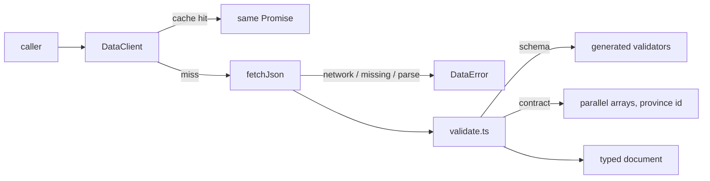

# Data Loader (`src/data/`)

The only way the app reads data products. Components import from `src/data` (the `index.ts` barrel) and never `fetch` files themselves. The client is plain TypeScript. React access goes through `DataProvider` and the hooks below.

```text
src/data/
  index.ts           # public API (createDataClient, indexCells, DataError, types)
  client.ts          # fetching, caching, path resolution via the manifest
  validate.ts        # schema validation + contract checks the schemas cannot express
  errors.ts          # DataError + DataErrorKind
  DataProvider.tsx   # one shared DataClient (and cache) for the app; tests pass a fake `client`
  context.ts         # DataContext + useDataClient()
  hooks.ts           # useResource + useManifest / useProvinces / useDaily / useCells
  generated/         # GENERATED from public/data/v1/schema/ (committed, never edited)
    types.ts         #   Manifest, ProvincesCollection, ProvinceDaily, MonthlySeries, CellsCollection
    validators.js    #   Ajv standalone validators (no runtime dependency, ~8 KB gzip)
    validators.d.ts
scripts/gen-data-contract.mjs   # the generator
```

## Usage
```ts
import { createDataClient, indexCells, DataError } from './data'

const data = createDataClient()            // base URL `${import.meta.env.BASE_URL}data/v1/`
const manifest = await data.manifest()
const provinces = await data.provinces()   // path from manifest.files.provinces
const daily = await data.daily('ID-KT')    // path from manifest.provinces[].daily (lazy)
const monthly = await data.monthly(null)   // Indonesia; data.monthly('ID-KT') for a province
const cells = await data.cells('ID-KT', '2020') // path from manifest.provinces[].cells['2020']

try { await data.cells('ID-XX', '2020') } catch (e) {
  if (e instanceof DataError) showError(e.kind, e.file)
}
```



## React hooks
```tsx
const manifest = useManifest()               // { status: 'loading' } | { status: 'ready', data } | { status: 'error', error }
if (manifest.status === 'error') return <DataErrorState error={manifest.error} onRetry={manifest.retry} />
const cells = useCells(selectedId, year)     // null province or year → stays 'loading', nothing fetched
const monthly = useMonthly(selectedId)      // null → Indonesia
```
- `useResource(key, load)`: `key` identifies the request. When it changes, the old result is discarded, and a late result for an old key is ignored. `retry()` re-runs the load (the client already evicted the failed promise).
- `load` is an inline function. The effect depends on `key`, not on `load`.

## Behaviour
- **One request per file.** Concurrent and repeated calls share one Promise. A failed load is evicted, so the next call retries.
- **Paths come from the manifest** (schema-validated strings), never built from a naming convention. An unknown province id is a `contract` error.
- **Error kinds:** `network` (fetch threw, or status other than 404/2xx), `missing` (404, or an HTML response: Vite's dev server answers unknown paths with `index.html` and status 200), `parse`, `schema`, `contract`. The message always starts with the file path.
- **Contract checks beyond the schema:**
  - daily (`dates, status, …`) and monthly (`months, status, …`) arrays are equal length, and each cell's six per-date arrays too (the error names the `cell_id`);
  - `daily.province_id`, `monthly.scope`/`province_id`, and `cells.province_id`/`year` match the request;
  - `provinces.geojson` lists the same provinces as the manifest, with `totals_by_year` and `n_active_cells_by_year` for every covered year;
  - a year missing from `manifest.provinces[].cells` is a `contract` error.
- `indexCells` exists because MapLibre stringifies array properties on queried features (see [data-products.md](data-products.md)).

## Code generation
- `npm run gen:data` regenerates `src/data/generated/`. `npm run check:data` fails if it's stale. Run it after every new export.
- Types use `additionalProperties: false`, so undeclared fields stay out of the types (validation still follows the schemas exactly).
- A property listed in `required` but not described in `properties` is typed **`unknown`**, not dropped (a guard for future schema changes; none today).
- Ajv: draft 2020-12, `validateFormats: false` (the schemas' `pattern` already checks dates; `format` is annotation only), `strict: false`.

## Schema coverage
The schemas type every field the app uses: nested manifest objects, series definitions, coverage dates, `series_notes`, boundaries, file paths (restricted to `[A-Za-z0-9_.-]` segments), and polygon/point coordinates as `[lon, lat]` tuples with range checks. **No generated field is `unknown`.** If a future schema leaves a required field undescribed, the generator types it `unknown` (it is not dropped). Report that to `../pipeline` instead of narrowing it locally.

Known limits, still enforced by hand or not at all:
- The equal length of parallel arrays (checked in `validate.ts`).
- The path pattern allows `..` segments, so a path could in principle point outside the data root. The data is first-party, so this is low risk; tightening it is a possible exporter request.

## Tests (`tests/unit/data/`)
- `hooks.test.tsx`: loading → ready, error + retry, stale result dropped on key change, null key.
- `validate.test.ts`: valid fixtures, schema errors, contract errors (wrong year/province/scope, unequal arrays, missing year totals), `null` accepted for missing.
- `client.test.ts`: fake `fetch` covering paths (incl. year files and Indonesia monthly), caching, retry, base URL, every error kind, unknown year.
- `exported-data.test.ts`: validates the real `public/data/v1/` export (manifest, provinces, Indonesia monthly, and for every province: daily, monthly, and every year's cells, each year listed) when present; ≈0.4 s.

Related: [data-products.md](data-products.md), [../practices.md](../practices.md)
