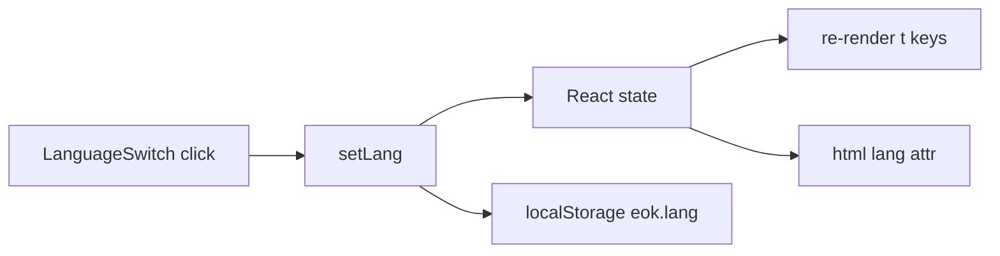

# Internationalisation

Two languages: `id` (Bahasa Indonesia, **default**) and `en`. No i18n library. A typed dictionary plus a React context.

## Contract
- `src/i18n/strings.ts`: `id` is the source of keys. `en` is typed `Strings = Record<StringKey, string>`, so a missing English key fails `tsc`.
- `useI18n()` (from `src/i18n/context.ts`) returns `{ lang, setLang, t, formatNumber, formatDate }`. It throws if used outside `<I18nProvider>`.
- `t(key, vars)` replaces `{name}` placeholders. A test checks that both languages use the same placeholders per key.
- `formatNumber` uses `Intl.NumberFormat` (`id-ID` → `63.725`, `en-GB` → `63,725`). `formatDate('2019-08-01')` formats a WIB calendar date in UTC, so it never shifts a day (`1 Agu 2019` / `1 Aug 2019`).
- The provider reads/writes `localStorage['eok.lang']` (try/catch) and keeps `<html lang>` in sync.
- Domain terms in Bahasa follow [../terminology.md](../terminology.md) (e.g. "titik panas", never "api" for a detection). The metric keeps its **English name, "Active cell-days" / "active cell-day", in both languages** (owner decision, 2026-10-22) until a better Bahasa translation is agreed. The surrounding sentences are translated.
- Sensor/series labels come from `manifest.series[*].label` (data, not the dictionary). Province names come from the data and stay **English for now** (owner decision). Converting them to Indonesian names is on the roadmap.

```ts
const { t, lang, setLang } = useI18n()
setLang('en')
t('app.tagline') // "History of satellite hotspots across Indonesia"
```

## Language switch
`src/components/LanguageSwitch.tsx`: an ID/EN segmented control, **always visible at the top right** of the header (owner requirement). Buttons use `aria-pressed`, `lang`, and a full language name as `title`. The group is labelled "Bahasa"/"Language".



Tests: `tests/unit/language-switch.test.tsx` covers the default `id`, switching, persistence, number/date/placeholder formatting, English completeness and placeholder parity.

Related: [../architecture/stack.md](../architecture/stack.md)
