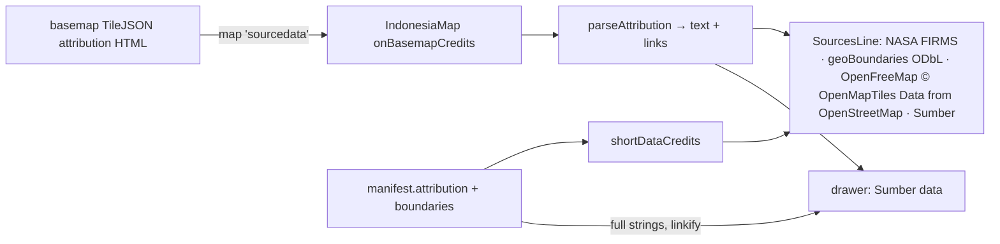

# Attribution (`src/map/attribution.ts`, `SourcesLine`, `SourcesSection`)

Owner decision (2026-10-22): credits sit in **one tiny line at the bottom edge**, like Google Maps, and the full wording is in the drawer. MapLibre's own attribution box is not used.

## Rules (OSMF Attribution Guidelines, checked 2026-10-22)
- The credit must name **"OpenStreetMap"** and make the ODbL clear. Linking "OpenStreetMap" to `openstreetmap.org/copyright` satisfies this.
- It must be **visible without interaction** (it may only collapse after a dismiss action, on map interaction, or after 5 s). So the line is never folded behind an ⓘ.
- It must be **readable** (they point to WCAG): 11 px, full-contrast `--c-text` on the glass surface, not faint grey.
- OpenFreeMap requires "OpenFreeMap © OpenMapTiles Data from OpenStreetMap" (the OpenFreeMap part is optional).
- NASA FIRMS asks to be acknowledged when its data is used.



## Pieces
- `parseAttribution(html)`: uses DOMParser to turn a tile source's attribution HTML into `{ text, href? }[]`. Only `http(s)` links are kept and no HTML is ever injected, because the credit comes from a third-party server.
- `IndonesiaMap` collects `attribution` from every basemap style source on `sourcedata` (skipping ours) and calls `onBasemapCredits` when it changes. So the credit stays correct if the basemap changes.
- `shortDataCredits(manifest)`: "NASA FIRMS" (link: the first URL in the FIRMS attribution string) and "geoBoundaries (ODbL)" (link: `boundaries.url`; licence short name from the trailing parenthesis of `boundaries.license`). These short names are display labels; the full wording comes from the manifest.
- `linkify(text)`: bare URLs in the manifest strings become links in the drawer.
- **Sources line text:** `NASA FIRMS · geoBoundaries (ODbL) · OpenFreeMap © OpenMapTiles Data from OpenStreetMap · Sumber`. "Sumber"/"Sources" opens the drawer and scrolls to `#sources`.
- Layout: desktop bottom-left with an open top-right corner. Narrow: full width, wraps to two lines.

```ts
parseAttribution('<a href="https://openfreemap.org">OpenFreeMap</a> <a href="https://www.openmaptiles.org/">&copy; OpenMapTiles</a> Data from <a href="https://www.openstreetmap.org/copyright">OpenStreetMap</a>')
// [{text:'OpenFreeMap',href}, {text:'© OpenMapTiles',href}, {text:'Data from'}, {text:'OpenStreetMap',href:'…/copyright'}]
```

## Tests
- `tests/unit/attribution.test.ts`: OpenFreeMap credit parsing, scripts and `javascript:` links dropped, short data credits, linkify.
- e2e: the footer is a single line (< 24 px) on the bottom edge, there is no `.maplibregl-ctrl-attrib`, and "Sumber" scrolls to the credits.

Related: [summary.md](summary.md), [../ui/layout.md](../ui/layout.md)
