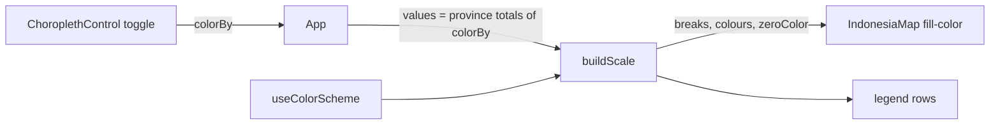

# Province Choropleth (`src/map/choropleth.ts`)

Owner decision (2026-10-22): provinces are shaded by **one sensor at a time**, and the user switches between MODIS and VIIRS S-NPP. Two series are never combined into one colour.



## Rules
- **Default: `COLOR_BY[0]` = `modis`**, the first series in the manifest order, so neither sensor is favoured by a choice in code. `viirs_all` is not offered (it jumps in 2018 and needs its warning).
- **Each sensor has its own classes.** Breaks are computed from that sensor's province totals only. VIIRS counts ~3× MODIS, so a shared scale would just paint VIIRS darker. The legend says "Tiap sensor punya skala sendiri. Jangan bandingkan warna antar sensor."
- **Single-hue ramp in the sensor's own colour** (MODIS `#2a78d6` blue, VIIRS `#eb6834` orange), so the colour also signals which sensor is shown. The toggle button takes the same colour, and the label always names the sensor.
- **Zero is its own grey class** (`ZERO_COLOR`), different from the lightest step.
- Classes are a display grouping of exported totals, not a new metric. No numbers are derived.

## Per year
- The values come from `scaleValues(provinces, series, year)` ([../map/summary.md](summary.md) and `src/map/years.ts`).
  - **For a picked year: one scale per sensor, fixed across years**, with breaks from every province × year value. So a crisis year is visibly darker (2019 vs 2020 in the trial export).
  - **For "Semua tahun":** its own breaks from the all-years totals.
- The map shades with the picked year's exported totals (`provinceTotals`), flattened into `total_modis` / `total_viirs_snpp`.

## Classification
- 5 classes: quantiles (20/40/60/80 %) of the non-zero totals, rounded to two significant digits (`niceRound`). Duplicates collapse, so flat data gives fewer classes, and the ramp keeps its strong end.
- Trial export (MODIS, single year): steps 1–129 · 130–239 · 240–429 · 430–1.399 · 1.400–16.345. All years: 1–309 · … · 4.800–16.990.
- Legend rows: `0`, then inclusive ranges `1–129`, `130–229`, …, `2.800–14.551` (formatted per language).

```ts
const scale = buildScale('viirs_snpp', provinces.map((p) => p.totals.viirs_snpp), '#eb6834', 'light')
map.setPaintProperty('provinces-fill', 'fill-color', fillColorExpression(scale))
// ['case', ['<=', ['get','total_viirs_snpp'], 0], zero, ['step', ['get','total_viirs_snpp'], c1, 490, c2, 1500, c3, …]]
```

## Ramp
- Light mode: tints 82 % / 62 % / 38 % white → pure hue → 35 % black (light to dark).
- Dark mode: 72 % / 50 % / 25 % background `#1a1a18` → pure hue → 30 % white (dark to bright).
- Fill opacity 0.85 (0.95 on hover). At 0.75 the grey basemap muddied the dark classes.

## Map integration
MapLibre stringifies nested properties, so `IndonesiaMap` adds flat `total_modis` / `total_viirs_snpp` copies of `totals` to the source data (same values). The `scale` prop is applied on `style.load` and via `setPaintProperty` when it changes.

## UI
- `ChoroplethSection` (first section of the drawer): toggle (`aria-pressed` buttons), legend title, vertical legend (swatch + range), note.
- `MiniLegend` (always on the map, bottom centre): active sensor chip, ramp, "0 – max Active cell-days". It opens the drawer, so the colours are never shown without their key ([../ui/layout.md](../ui/layout.md)).

## Tests
- `tests/unit/choropleth.test.ts`: `niceRound`, breaks, flat and zero data, ramp lightness is monotonic in both themes, legend ranges, the expression references only the chosen series.
- `tests/unit/app.test.tsx`: MODIS is the default, the toggle switches, the legend title follows, the note is present, the mini legend shows sensor + range with the drawer closed.
- `tests/e2e/map.spec.ts`: the live `fill-color` paint property switches from `total_modis` to `total_viirs_snpp`.

Related: [summary.md](summary.md), [../ui/layout.md](../ui/layout.md)
