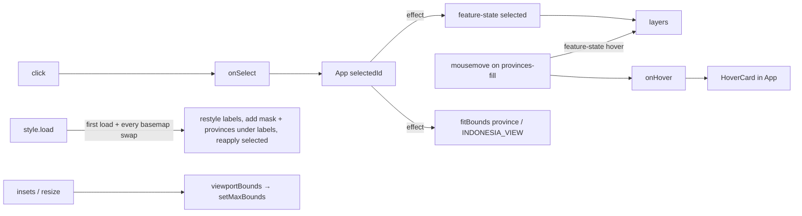

# Map (`src/map/`)

The national map: MapLibre GL JS 6 on an OpenFreeMap basemap, with province polygons from `provinces.geojson`. It supports hover, click-to-select and a camera fly-in. Cell dots are not built yet ([../plans/roadmap.md](../plans/roadmap.md)).

```text
src/map/
  IndonesiaMap.tsx   # the MapLibre component (imperative map inside one React effect)
  basemap.ts         # OpenFreeMap style URLs + useColorScheme()
  geometry.ts        # INDONESIA_VIEW, viewportBounds() pan limit, geometryBounds(), maskFrame()
  choropleth.ts      # one-sensor-at-a-time province shading (see choropleth.md)
```

## Basemap: OpenFreeMap
Terms checked 2026-10-22 on openfreemap.org: commercial use allowed, no API key, no registration, no limits on views. The required attribution, "OpenFreeMap © OpenMapTiles Data from OpenStreetMap", comes from the tile metadata (`https://tiles.openfreemap.org/planet`). MapLibre's attribution control is **not** used; the map reports the credit through `onBasemapCredits` and the app's sources line shows it ([attribution.md](attribution.md)).
- Light: `https://tiles.openfreemap.org/styles/positron`. Dark: `.../styles/dark`. The style follows `prefers-color-scheme` live.
- Worker setup for Vite, as in OpenFreeMap's quick start: `setWorkerUrl(workerUrl)` with `maplibre-gl/dist/maplibre-gl-worker.mjs?worker&url`.

## Component contract
```tsx
<IndonesiaMap
  provinces={provinces}            // generated ProvincesCollection, passed to MapLibre as-is
  selectedId={selectedId}          // controlled by App
  scale={scale}                    // ChoroplethScale from buildScale(), see choropleth.md
  insets={insets}                  // px covered by floating UI (App.overlayInsets)
  onSelect={setSelectedId}         // map click
  onHover={setHover}               // { provinceId, x, y, nearRightEdge } | null
  onBasemapCredits={…}             // basemap TileJSON attribution HTML, see attribution.md
  label={t('map.label')}
/>
```



## Behaviour and invariants
- The map is **created once**. Later props are applied by effects, and long-lived handlers read the latest props through a ref.
- The source uses `promoteId: 'province_id'`, so feature-state ids are province ids.
- Layers: `provinces-fill` (choropleth by the selected sensor, [choropleth.md](choropleth.md); opacity 0.85, 0.95 on hover) and `provinces-line` (thin; `--c-map-selected` and thicker on hover/selection). Line colours come from CSS tokens read on `style.load`.
- The source data adds flat `total_modis` / `total_viirs_snpp` properties, because MapLibre stringifies the nested `totals`.
- `setStyle` (light/dark switch) drops custom layers. They are re-added on `style.load` and the selection is restored.
## Staying on Indonesia
- **The pan limit is sized to the viewport.** `viewportBounds(INDONESIA_VIEW, width, height, insets)` returns the box that, when it exactly fills the map, shows Indonesia as large as possible in the area *not* covered by floating UI. It is used as `maxBounds` (and the initial `bounds`) with `minZoom: 0`. So:
  - at the widest zoom, all of Indonesia (94.7°–141.1°E, 11.2°S–6.3°N) is visible and nothing can pan;
  - zoomed in, panning stays inside the box;
  - zooming out beyond it is impossible (MapLibre keeps the viewport inside `maxBounds`).
- It is recomputed on map `resize` and whenever `insets` change (card hidden or shown, breakpoint, header height). With no selection the camera re-fits to the new box.
- **Animated both ways, never snapping.** The camera effect:
  1. calls `setMaxBounds(null)` (a smaller new limit, e.g. when the drawer closes, would otherwise snap the camera instantly);
  2. animates to the target;
  3. re-applies `setMaxBounds(panLimit())` once the move ends.
- **The target is computed inside the limit before animating.** For a province, `cameraForBounds(…, padding = insets + 32, maxZoom 9)` gives the ideal camera, then `clampCenter(limit, center, zoom, w, h)` (geometry.ts) shifts the centre just enough that the view stays inside the limit, and `easeTo` goes there. Without this, provinces at Indonesia's edge were centred outside the limit and snapped back unanimated when it was re-applied: Aceh on select (1.2°), and Aceh, North Sumatra and Papua (7°) when the drawer closed. An edge province therefore sits slightly off-centre, against the limit.
- **Only the latest move re-locks the limit**, once the map is still. A move counter is checked, and the listener is registered *after* starting the new move. An interrupted move (a quick second click, the drawer closing mid-flight) stops part-way, possibly outside the limit, and must not re-apply it.
- Regression test: an e2e watches every `moveend` and fails if the camera changes two frames later while no animation runs. It covers AC/SU/PA plus an interrupted fly-in; with the clamp removed it catches a 7.2° snap.
- The limiting axis is exact: Indonesia is ~2.6:1, so on desktop the width fits exactly and the extra height (and the panel's width) shows sea or neighbours. On a phone the box is much taller than Indonesia.
- **Mask:** a plain rectangle (`maskFrame`, 60–180°E, 45°S–40°N), colour `--c-map-mask` at 0.78, drawn between the basemap shapes and the provinces. Everything that is not Indonesian land is flattened, and the province colours sit on top. Neighbouring countries' labels stay visible (a possible follow-up is dimming them with a `within` expression).

## Layer order and labels
- Bottom to top: basemap shapes → `outside-mask` → `provinces-fill` → `provinces-line` → **basemap labels**. Our layers use `beforeId` = the first basemap symbol layer.
- On `style.load`, every basemap symbol layer with `text-field` is restyled for contrast on any shade: `text-color: --c-map-label`, `text-halo-color: --c-map-label-halo`, halo 1.4 px (light: near-black on white halo; dark: off-white on black halo). The dark style's own labels became unreadable smudges on bright shades.

## Camera
- Selecting a province calls `fitBounds` on its display-polygon bbox, padded by `insets` + 32 px (maxZoom 9, 1 s, instant with `prefers-reduced-motion`). Clearing it fits the pan-limit box.
- Controls: zoom buttons at the bottom right with the reset-view control above them (it clears the selected province via `onReset`, or fits the pan limit when nothing is selected; see [../ui/layout.md](../ui/layout.md)). No attribution control: see [attribution.md](attribution.md).
- In dev only, the map is exposed as `window.__eokMap` for Playwright.

## Lessons
- **`maplibre-gl.css` loads after our stylesheet**, so any rule targeting a `.maplibregl-*` class needs higher specificity (scope it under `.app-main`). Examples: `.maplibregl-ctrl-bottom-right { bottom: 0 }` overrode our offsets, and the container case below.
- `maplibre-gl.css` sets `.maplibregl-map { position: relative }` on the container. A same-specificity `.map { position: absolute }` loses, and the map collapses to 0×0 (blank map, no controls). Use `.map-wrap > .map`.
- **`maxBounds` beats `minZoom`.** MapLibre never shows anything outside `maxBounds`, so a fixed box either clips Indonesia (box too small for the viewport's aspect) or lets users wander (box too big). Sizing the box to the viewport (`viewportBounds`) solves both.
- **A rectangle with the 34 provinces as holes does not render.** Neighbouring provinces share edges, and touching holes tessellate into wedge artefacts across Kalimantan and Sulawesi. Use a plain rectangle under the provinces instead.
- Releasing a map drag over a floating card leaves MapLibre's drag-pan active until the pointer moves back over the map (it then clears itself). This is harmless, because at the widest zoom nothing can pan. Playwright can't release a drag outside the window either, so keep scripted drags inside the viewport and off the cards.
- The generated `ProvincesCollection` type is assignable to MapLibre's GeoJSON type with no cast.
- MapLibre is most of the bundle: about 368 KB gzip for the main chunk, plus a 518 KB worker that loads separately. Consider lazy-loading the map later if the first load matters.

Related: [choropleth.md](choropleth.md), [../ui/layout.md](../ui/layout.md), [../data/loader.md](../data/loader.md), [../data/data-products.md](../data/data-products.md)
