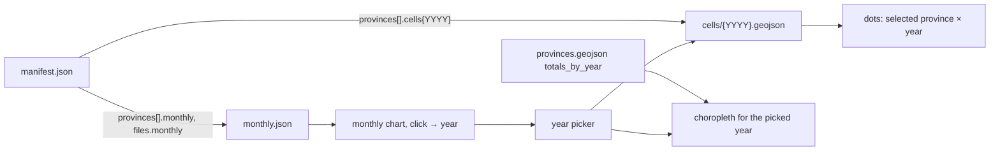

# Multi-Year Data: Owner Decisions and Web Design

**Status: implemented.** The pipeline exports multi-year data products (contract v1; layout and invariants in [../data/data-products.md](../data/data-products.md)), and the web app reads them with a year picker, per-year choropleth and dots, and the monthly chart ([../chart/monthly.md](../chart/monthly.md)). This file keeps the owner decisions and how the web app applies them.

## Decisions (owner, 2026-10-24)
- **Time unit: WIB calendar year.** The UI offers one year at a time plus "Semua tahun" (all years).
- **Dots only for a picked year** (no all-years cell file).
- **Monthly line chart over all years**, MODIS and VIIRS S-NPP, per province and for Indonesia.
- **"Indonesia" = sum of the provinces.** Cells in the FIRMS bounding box but in no province are a separate `outside_provinces` number, never part of Indonesia's series.
- **Dense series with status:** every date or month in range, with status `complete | partial | missing`. Values are `null` when missing, never 0.

## Data flow in the app

## How the web app applies them
1. **Data:** base path `data/v1/`; loaders `monthly(provinceId | null)` and `cells(provinceId, year)` from `manifest.provinces[].cells[year]`. Contract checks: parallel arrays in daily/monthly/cells; `cells.province_id`/`year` match the request; daily/monthly `province_id` matches.
2. **Year picker** (dots exist per year only): "Semua tahun" + every key of `coverage.years`, with partial years marked. Proposed default: **the latest complete year** (dots show as soon as a province is picked). The owner can switch the default to "Semua tahun".
3. **Choropleth per year** from `totals_by_year` (or `totals` for all years). Proposed classes: **one scale per sensor fixed across years** (breaks from every province × year value), so crisis years stand out; "Semua tahun" has its own breaks.
4. **Indonesia figures** from `totals.indonesia[_by_year]`, with **outside provinces shown separately** ("tidak termasuk").
5. **Dots** for the selected province × picked year; none with "Semua tahun".
6. **Monthly chart** (uPlot) from `monthly.json`.
   - One shared y-axis; never stacked, summed or on two y-axes.
   - `null` → gap; partial months marked.
   - `platform_periods` markers labelled "first detection in this data".
   - The picked year shaded; clicking a month picks its year.
   - Caveats shown with it; a table alternative.

## Open
- Pipeline side: an NRT "provisional" layer, S-NPP status after 2026.
- Owner: confirm the default year (latest complete) and the fixed-across-years scale, both implemented as proposed.
- Later: a per-year calendar heatmap ("find the peak season") from `monthly.json`.

Related: [roadmap.md](roadmap.md), [../data/data-products.md](../data/data-products.md), [../map/cells.md](../map/cells.md), [../map/choropleth.md](../map/choropleth.md)
