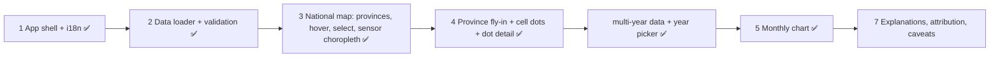

# Roadmap

## Next
7. Metric explainer, sensor notes, outside-provinces note, boundary year, attribution.
8. **Indonesian province names** (e.g. "Kalimantan Tengah" instead of "Central Kalimantan"). The names currently come from the export in English. Decide whether the Python exporter adds them (preferred: one source of truth) or the UI carries a dictionary keyed by `province_id`.

## Requests to the Python exporter
- Optional: reject `..` segments in the schema path pattern.
- Fill `pipeline.git_commit` in exports.

## Multi-year data
The owner decisions are in [multi-year.md](multi-year.md): year as the time unit, dots only for a picked year, a monthly MODIS/VIIRS chart (Jan 2012 → now), per-year totals, `monthly.json`, coverage periods (missing ≠ zero) and per-year cell files. The web app reads the multi-year contract v1 (2012–2026) with a year picker and the monthly chart ([../chart/monthly.md](../chart/monthly.md)).

## Open decisions (owner)
- A Bahasa translation for "active cell-days" (English is used in both languages until then).
- Where the data is hosted (it is git-ignored now). This affects deploy.
- Code and data licences.
- Static host (GitHub Pages vs Cloudflare Pages).

Related: [../data/data-products.md](../data/data-products.md), [../architecture/stack.md](../architecture/stack.md)
