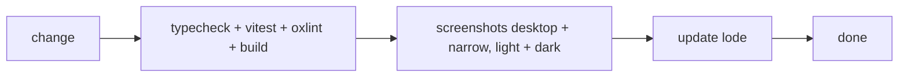

# Practices

## No science in the browser
Display, filter and format exported values only. Any new metric is requested from the Python exporter. Province totals come from `provinces.geojson`. They are never recomputed by summing cells.

## Strings always go through i18n
No user-visible literal text in components. Add the key to `src/i18n/strings.ts` in both `id` and `en` (the `Strings` type makes a missing English key a compile error).

```tsx
const { t } = useI18n()
return <p>{t('map.placeholder')}</p>
```

## Data access is separate from presentation
`src/data/` loads and validates data products and exposes typed results. Components never `fetch` files directly. Never hand-edit `src/data/generated/`. After a new export, run `npm run gen:data`, and treat schema gaps as requests to `../pipeline`, not as local workarounds ([data/loader.md](data/loader.md)).

## Colours and theming
Use the CSS tokens in `src/styles/index.css` (`--c-modis`, `--c-viirs`, `--c-both`, `--c-bg`, …). Light and dark come from `prefers-color-scheme`. Identity is never shown by colour alone.

## Web first, still narrow-safe
Design for desktop first. Check every UI change at 1440×900 and at 390px width, in light and dark, with screenshots (Playwright + Chromium are installed).

## Verification before "done"
`npm run typecheck && npm test && npm run lint && npm run check:data && npm run build && npm run test:e2e`, plus screenshots (desktop 1440×900 light and dark, 390px narrow). Report anything that could not be checked.

## Testing notes
- Unit tests live in `tests/unit/` (Vitest + jsdom + Testing Library, globals on). They are type-checked by `tsconfig.test.json`, the only config with Node types. `src/` (`tsconfig.app.json`) has browser types only.
- File paths in tests: in **Vitest** (jsdom) use `__dirname`, because `import.meta.url` is not a `file://` URL there. In **Playwright** (ESM) use `fileURLToPath(new URL(..., import.meta.url))`, because `__dirname` is undefined.
- E2E: `tests/e2e/` via `playwright.config.ts`. It starts its own Vite dev server on port 5180, uses SwiftShader WebGL, and routes `tiles.openfreemap.org` to a blank style. It reads the MapLibre map from `window.__eokMap` (dev only). It is skipped when `public/data/v1` is absent.
- `tests/setup.ts` also stubs `window.matchMedia` (light mode, no reduced motion), because jsdom lacks it and `useColorScheme` needs it.
- `tests/setup.ts` also stubs `Element.prototype.scrollIntoView` and `scrollTo` (jsdom lacks them).
- Never use `scrollIntoView` for content inside a sliding or off-screen panel: it scrolls every scrollable ancestor, including an `overflow: hidden` page. Scroll the panel's own scroller instead.
- A `<footer>` is the `contentinfo` landmark only **outside** `<main>`/sectioning content. jsdom/Testing Library is lenient, Playwright follows the spec.
- Playwright's `getByRole(..., { name })` is a case-insensitive **substring** match (`'EN'` also matches "m**en**urut"); use `exact: true` for short names. Testing Library is exact by default.
- Components that need WebGL are mocked in Vitest (`vi.mock('../../src/map/IndonesiaMap', ...)`).
- Node 25 has a built-in `localStorage` that shadows jsdom's. `tests/setup.ts` swaps in an in-memory `Storage`. Keep it.
- Code that touches `localStorage` wraps it in try/catch, because storage can be unavailable.



Related: [architecture/stack.md](architecture/stack.md), [i18n/i18n.md](i18n/i18n.md)
