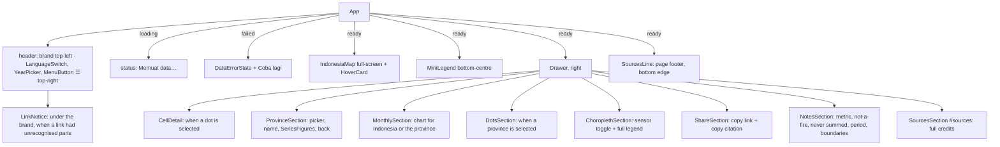

# Page Layout and Components

`App.tsx` owns the page state: `year` (picked, else `defaultYear(manifest)`), `selectedId`, `selectedCellId`, `showOtherViirs`, `hover`, `colorBy`, `drawerOpen`, `basemapCredits` (and `useCells(selectedId, year)`). The opened link sets the initial view, and the address follows the state ([share-links.md](share-links.md)). The **map fills the whole window**, and everything else floats over it: the header (brand + language switch + ☰), the **drawer**, the **mini legend**, and the **sources line**. It renders one of three states: **loading**, **error** (`DataErrorState` *instead of* the map, so wrong or empty data is never drawn), or **ready**.

## Drawer (owner decision 2026-10-22)
The two earlier cards ("Warnai peta menurut" and the information card) are combined into one **non-modal drawer** behind a ☰ button to the right of the ID/EN switch.
- `Drawer.tsx`: `<aside aria-label="Menu">`. The map stays interactive behind it. It slides in and out from the right (0.3 s transform, instant with `prefers-reduced-motion`). When closed it stays mounted with `aria-hidden`, `inert`, and `visibility: hidden` after the slide. It has its own × close button.
- `MenuButton.tsx`: a **35 px circle** matching the ID/EN pill (same height, glass, border, shadow), with `aria-expanded`, `aria-controls="drawer"` and the label "Buka/Tutup menu". Filled when open.
- **Esc** closes the drawer and returns focus to ☰.
- **Initial state:** desktop opens on the first visit, then follows the visitor's last choice (`localStorage['eok.drawer']`, try/catch). Narrow (≤800 px) always starts closed and does not store.
- **Selecting a province** (map click or picker) opens the drawer on it. The mini legend opens it too.
- **"Sumber"** opens the drawer and scrolls **only `.drawer__scroll`** to `#sources` (computed `offsetTop`): an instant jump if the drawer was closed, so it slides in already there; smooth if it was open. `scrollIntoView` must not be used here: it also scrolled the page sideways to reach the still off-screen drawer, so the whole view lurched and bounced back. As a second guard, `html, body` use `overflow: clip` (unlike `hidden`, it cannot be scrolled from code).
- Desktop: top 64, right 12, bottom 34, width 344 (`DRAWER_W` in App, mirrored in CSS). Narrow: full width below the header (top 56, bottom 44).

## Always on the map
- **MiniLegend** (`MiniLegend.tsx`): a pill button at the bottom centre. With no province selected it shows the active sensor chip, the zero + class ramp and "0 – max Active cell-days". With a province selected it shows the **dot key** instead ([../map/cells.md](../map/cells.md)). The colours are never shown without their key, even with the drawer closed. It is **fixed at the window's bottom centre** and does not move when the drawer opens. The one exception is windows too narrow for it to clear the open drawer (< ~1240 px), where it is held just left of the drawer (`left: min(50%, 100% − 368 px − 240 px)`).
- **SourcesLine** (`SourcesLine.tsx`): see [../map/attribution.md](../map/attribution.md). A `<footer>` rendered **outside `<main>`**, so it is the page's `contentinfo` landmark (inside `<main>` a footer has no landmark role, and Playwright then can't find it by role).
- Zoom buttons at the bottom right, with the **reset-view button (⤢) stacked above them** (owner, 2026-10-26):
  - It returns to the starting state: with a province selected it **clears the selection** (and any picked dot, via `select(null)` → `onReset`), and the camera effect flies back. With nothing selected it flies back itself (`fitBounds` to the pan limit). The picked year and the drawer stay as they are (owner, 2026-10-26).
  - Its label follows the language ("Kembali ke tampilan awal" / "Back to the starting view").
  - It is a MapLibre `IControl` (`ResetViewControl` in IndonesiaMap), added after the zoom control so MapLibre stacks it above.
  - Icon: Lucide "fullscreen" (ISC licence, credited in a code comment), 18 px, centred (`.app-main .reset-view button` is a grid; unscoped, MapLibre's `display: block` won and the icon sat on a text baseline).
- The group shifts left of the open drawer (`right: 356px`) and sits 24 px up on desktop. At ≤800 px it sits above the mini legend (84 px), and only the zoom buttons are hidden (pinch-zoom).
- **These offsets are scoped as `.app-main .maplibregl-ctrl-bottom-right`:** `maplibre-gl.css` loads after `index.css` and wins at equal specificity (its `bottom: 0` silently overrode an unscoped rule).

## Year picker (`YearPicker.tsx`, `src/map/years.ts`)
- A glass pill **in the top-right group, between ID/EN and ☰**, the same 35 px height (owner, 2026-10-26). On phones it drops the "Tahun" label and narrows.
- A `<select>` labelled "Tahun" with "Semua tahun" + covered years, newest first. Partial years read "2019 (parsial)".
- **The pill is as wide as the current label** (2020 = 119 px). A native `<select>` is always as wide as its longest option, so the pill shows the label as text plus a Lucide chevron, and the real `<select>` lies over the whole pill (`position: absolute; inset: 0; opacity: 0`). Clicks, keyboard, the native list and its accessible name ("Tahun", the text span is `aria-hidden`) all stay native. The focus ring comes from `.year-picker:has(select:focus-visible)`. CSS `field-sizing: content` would do this natively, but browser support is incomplete.
- **Default: the latest complete year** (`defaultYear`), until the visitor picks one. Changing the year clears the picked dot.
- Everything shown follows the year:
  - province colours (`totals_by_year`);
  - province and Indonesia figures (heading "Active cell-days · 2020");
  - active cells (`n_active_cells_by_year`, not shown for all years);
  - the hover card;
  - dots (none for all years).
- A partial year shows "Tahun parsial: tidak semua tanggal tercakup."
- The Indonesia view adds the **outside provinces** line ("tidak termasuk di atas").

## Other components
- **SeriesFigures**: `modis` and `viirs_snpp` in two side-by-side tiles (swatch + manifest label; never summed; no `viirs_all`).
- **HoverCard**: follows the pointer with name, metric label, small figures and "Klik untuk memilih". It opens to the left near the drawer edge.
- **Credit**: renders credit parts as text and `target=_blank rel=noreferrer` links.

## Map insets (`overlayInsets` in App)
- top = measured header bottom + 12 (ResizeObserver, debounced 150 ms; fallback 56 without ResizeObserver, as in jsdom)
- right = 368 while the drawer is open on desktop, else 0 (the open drawer on narrow screens is temporary)
- bottom = 84 (mini legend + sources line)
- left = 0

## Invariants
- No numbers are computed in the UI: every figure is an exported total. Province names come from the data (English for now).
- The colour key is always visible on the map (mini legend), and the full legend and "own scale per sensor" note are in the drawer.

## Tests
- `tests/unit/app.test.tsx`: loading → ready (2020 default, Indonesia totals + outside line), year picker (partial label, 2019 figures, dots need a year, all years), colour toggle, drawer open/close via ☰, the mini legend and Esc (focus back to ☰), the closed drawer is `aria-hidden` + `inert`, the closed state is remembered, the mini legend shows sensor + range, the sources line → "Sumber" opens the drawer at "Sumber data", map selection opens the drawer, picker, error + retry. `IndonesiaMap` is mocked (no WebGL in jsdom).
- `tests/e2e/map.spec.ts`: national totals for the default year + footer credits, year picker (dots differ per year, none for all years), hover card, click → select + fly-in, back, picker, pan/zoom-out limit, reset button above zoom (back to start, clears the selection, keeps the year, label follows language), header order ID/EN → year → ☰, labels above provinces, closing the drawer re-fits with animation both ways, the drawer's four sections, Esc + the mini legend stays, round ☰ matching the switch height, legend centre unchanged when the drawer toggles, no page scroll when "Sumber" opens the drawer, a one-line footer on the bottom edge (no MapLibre attribution box) with "Sumber" scrolling to the credits, choropleth switch, English.

Related: [../map/summary.md](../map/summary.md), [../map/choropleth.md](../map/choropleth.md), [../map/attribution.md](../map/attribution.md)
