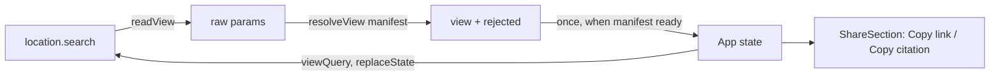

# Shareable Links and Citations

Every map view can be shared as a link and cited as a reference (owner, 2026-11-15). Pure logic is in
`src/share/view.ts`, the drawer section in `src/components/ShareSection.tsx`, wiring in `App.tsx`.

## Link format
Query parameters on the page URL. No hash routing, so it works on any static host.

```text
/?province=ID-RI&year=2019&sensor=viirs_snpp&cell=10123_456&other=1
```

| Param | Value | Missing | Invalid |
|---|---|---|---|
| `province` | a `province_id` in the manifest | Indonesia | ignored + notice |
| `year` | a covered WIB year, or `all` | `defaultYear(manifest)` | ignored + notice |
| `sensor` | `modis` or `viirs_snpp` (`COLOR_BY`) | `COLOR_BY[0]` | ignored + notice |
| `cell` | a `cell_id` (`\d+_\d+`) in that province × year file; needs `province` and a year (not `all`) | no dot | ignored + notice (checked once the cells load) |
| `other` | `1` shows other-VIIRS dots | hidden | ignored + notice |

- **Not in links:** language (each reader keeps their own choice; owner decision), camera (follows the province), drawer state, colour scheme.
- Opening a link with a province or cell opens the drawer on it, like selecting it by hand.
- Unknown parameters are dropped silently; known ones with bad values show a dismissible notice under the header ("Sebagian tautan tidak dikenali…").

## Address bar stays current
After the link is applied, every change of province, year, sensor, dot or the other-VIIRS switch rewrites the address with `history.replaceState` (no back-button history). The live address writes only what differs from the defaults: `year` only once picked, `sensor` only when not `COLOR_BY[0]`.



## Copy link and Cite this view (`ShareSection`, drawer, above "Tentang data")
- **Copy link** always writes `year` (or `all`) and `sensor` explicitly. Without them a link would drift: the default year moves as data is added.
- **Copy citation** builds a reference that records the data version, because links always show the current export and re-exports can change numbers:

  ```text
  Eyes on Karhutla (2026). Riau, 2019, VIIRS S-NPP, Active cell-days. Data: NASA FIRMS (MODIS, VIIRS),
  export 2026-11-14 (pipeline 65374d9). Accessed 2026-11-15. https://…/?province=ID-RI&year=2019&sensor=viirs_snpp
  ```

  Export date = `manifest.generated_at` (date part), commit = first 7 chars of `manifest.pipeline.git_commit` (left out when null), dates ISO in both languages. "All years" reads `Semua tahun (2012–2026)` with the covered year range. A picked dot adds `sel {cell_id}` / `cell {cell_id}`.
- Clipboard: `navigator.clipboard.writeText`. On success an `aria-live` line says it was copied. If the clipboard is unavailable or refused, the text is shown in a read-only field, pre-selected, to copy by hand.

## Invariants
- A link never changes data or computes anything: it only restores UI state from exported identifiers (`province_id`, `cell_id`, WIB year, series key).
- Links are versionless today. Keeping old exports online (pipeline Stage 2) would allow a `data=` parameter later; until then the citation is the record of the version.

## Tests
- `tests/unit/share-view.test.ts`: read / resolve / write round trip, rejections, explicit vs live query, citation text (with and without commit, all years, cell).
- `tests/unit/app.test.tsx`: a link restores province + year + sensor + dot and opens the drawer; bad params show the notice; the address follows the state; copy link / citation (and the manual fallback).
- `tests/e2e/map.spec.ts`: opening a link flies to the province with the year and sensor applied; selecting updates the address.

Related: [layout.md](layout.md), [../map/cells.md](../map/cells.md), [../plans/multi-year.md](../plans/multi-year.md)
